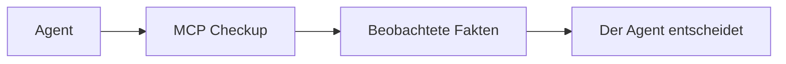

<h1 align="center">MCP Checkup</h1>

<p align="center"><strong>Schau hin, bevor dein Agent eine Verbindung aufbaut.</strong></p>

<p align="center">
  <a href="https://github.com/mcpcheckup/.github/blob/main/profile/README.md">English</a>
  · <a href="https://github.com/mcpcheckup/.github/blob/main/profile/README.zh-CN.md">简体中文</a>
  · <a href="https://github.com/mcpcheckup/.github/blob/main/profile/README.zh-TW.md">繁體中文</a>
  · <strong>Deutsch</strong>
  · <a href="https://github.com/mcpcheckup/.github/blob/main/profile/README.ja.md">日本語</a>
  · <a href="https://github.com/mcpcheckup/.github/blob/main/profile/README.es.md">Español</a>
  · <a href="https://github.com/mcpcheckup/.github/blob/main/profile/README.fr.md">Français</a>
</p>

<p align="center">
  <a href="https://mcpcheckup.com/mcp"></a>
  <a href="https://github.com/mcpcheckup/checks#use-mcp-checkup-from-your-agent"></a>
  <a href="https://github.com/mcpcheckup/checks/blob/main/LICENSE"></a>
  <a href="https://github.com/mcpcheckup/preflight/blob/main/LICENSE"></a>
</p>

MCP Checkup beobachtet öffentliche MCP-Server und veröffentlicht, was ein einzelner Lauf gesehen hat: ob der Endpunkt geantwortet hat, welche Protokollrevision er gesprochen hat, Fingerabdrücke der Tool-Namen und des `inputSchema` jedes Tools, öffentlich beobachtbare Authentifizierungsmetadaten und Hygienesignale in Tool-Namen und Beschreibungen. Ein signierter Lauf ist eine Attestierung, die du selbst prüfen kannst. Ein Lauf ohne Signatur wird als unsignierte Beobachtung ausgewiesen.

Fakten, keine Urteile. Jede Prüfung landet in genau einem von `VERIFIED`, `FAILED`, `OBSERVED_RISK` oder `UNVERIFIED`. Die Prüfungen werden nie zu einer Note oder einem Urteil zusammengezogen, eine nicht gelaufene Prüfung gilt nie als bestanden, und das Ergebnis ist kein Riegel vor der Verbindung. Der Agent entscheidet.

- Verzeichnis: [mcpcheckup.com/servers](https://mcpcheckup.com/servers)
- MCP-Endpunkt, Streamable HTTP, kein Konto und kein API-Schlüssel: `https://mcpcheckup.com/mcp`
- Offizielle MCP Registry: `com.mcpcheckup/mcp`
- Außerdem gelistet im [Claude Connectors Directory](https://claude.ai/directory/connectors/mcp-checkup) als Community-Connector, auf [MCP Collection](https://mcpcollection.com/server/mcp-checkup) und in der [ToolSDK MCP Registry](https://toolsdk-ai.github.io/toolsdk-mcp-registry/#%40toolsdk-remote%2Fmcpcheckup)

## Was festgehalten wird

Die Suite umfasst 15 Prüfungen am Protokoll selbst. Die Tabelle ist die Kurzform. Definitionen, Fehlersemantik und das Probe-Budget stehen in [`checks.json`](https://github.com/mcpcheckup/checks/blob/main/packages/checks/checks.json) und auf der Seite zur [Methodik](https://mcpcheckup.com/methodology).

| Prüfung | Was ein Lauf festhält |
| --- | --- |
| `reachability` | Ob der Endpunkt innerhalb des Probe-Budgets geantwortet hat. Ein verfehltes Budget ist `UNVERIFIED`, nicht `FAILED`. |
| `latency_profile` | p50 und p95 der Anfragen, deren Laufzeit die Probe gemessen hat. `VERIFIED` heißt: eine Zeit wurde gemessen. Es gibt keine Schwelle und keine Rangliste. |
| `transport_type` | Ob der Handshake über den Transport beantwortet wurde, den die Probe benutzt hat. |
| `protocol_revision` | Ob eine bekannte Protokollrevision erkannt wurde. Das ist keine Aussage, die Revision sei vollständig umgesetzt. |
| `discovery_handshake` | Ob `server/discover` oder der ältere `initialize`-Handshake zur erkannten Revision passt. |
| `tools_list` | Ob `tools/list` eine strukturell gültige Tool-Liste liefert. Geschäftstools werden nie aufgerufen. |
| `error_taxonomy` | Wenn der reservierte Aufruf gesendet wird: ob der Fehler die Form des Protokolls hat. Eine Abweichung ist `OBSERVED_RISK`. |
| `tls_certificate` | Ob das Zertifikat gültig, nicht abgelaufen, namensgleich und vollständig verkettet ist. Das sagt nicht, der Server sei sicher. |
| `redirect_policy` | Ob eine Weiterleitung auf einen anderen Host gewechselt ist. Ein Hostwechsel ist `OBSERVED_RISK`. |
| `auth_metadata` | Ob öffentlich beobachtbare Auth-Metadaten oder eine Challenge ohne Zugangsdaten wohlgeformt sind. Eine ungültige Struktur ist `OBSERVED_RISK`. Ist nichts zu beobachten, bleibt die Prüfung `UNVERIFIED`. Das prüft nicht, ob Authentifizierung tatsächlich durchgesetzt wird. Die Probe sendet nie Zugangsdaten. |
| `tool_description_hygiene` | Signale in Tool-Namen und Beschreibungen, darunter versteckte Zeichen und Text, der sich an den Agenten richtet. Ein Treffer ist `OBSERVED_RISK`, kein Urteil über die Absicht. |
| `toolset_fingerprint` | SHA-256 der Tool-Namen. `VERIFIED` heißt: der Fingerabdruck ließ sich berechnen, nicht, dass die Liste gleich geblieben ist. |
| `schema_fingerprint` | SHA-256 des `inputSchema` jedes Tools. Berechenbar, nicht „unverändert“. Eine geänderte Beschreibung bewegt keinen der beiden Fingerabdrücke. |
| `toolset_unchanged_vs_approved` | Ob die Tool-Namen zu einer freigegebenen Baseline passen. Ohne Baseline bleibt das `UNVERIFIED`. |
| `schema_unchanged_vs_approved` | Ob jedes `inputSchema` zu einer freigegebenen Baseline passt. Ohne Baseline bleibt das `UNVERIFIED`. |

Änderungen an Namen, Parametern und Beschreibungen vergleicht [`packages/toolset-diff`](https://github.com/mcpcheckup/checks/tree/main/packages/toolset-diff) Tool für Tool. Dieselben Änderungen stehen in `get_mcp_history`.

## So läuft es ab

Öffentliche Endpunkte aus MCP-Registries, dazu eine kurze handverlesene Menge, werden geprüft, ohne dass der Betreiber sich anmeldet. Server, die niemand beansprucht hat, werden alle 12 Stunden erneut geprüft. Die Berichtseite eines beanspruchten Servers zeigt, in welchem Takt dieser Server liegt.

Ein Lauf liest, was von außen sichtbar ist. Er prüft keinen Quelltext, ruft keine Geschäftstools auf und sendet keine Zugangsdaten. Für einen Fehlerpfad ruft er einen reservierten Tool-Namen auf, der absichtlich nicht existieren sollte. Der Aufruf entfällt, wenn der Name schon in der Liste steht, die Liste nicht vollständig gelesen werden kann oder der Server Zugangsdaten verlangt.

Fingerabdrücke von Tool-Namen und `inputSchema` sind SHA-256 über die Projektion `nfc-jcs/v1`: Unicode-NFC, danach das JSON Canonicalization Scheme aus RFC 8785. Die Methodik hält fest, dass diese Kombination selbst nicht RFC 8785 ist, weil die Spezifikation den Normalisierungsschritt verbietet. Es zählen nur die projizierten Felder. Ein neues Feld daneben verschiebt den Fingerabdruck nicht, eine geänderte Beschreibung auch nicht.

Ein signierter Lauf nennt den Commit der Check-Suite und einen `suite_digest` über `packages/checks`, in einem mit Ed25519 signierten DSSE-Umschlag. Die öffentlichen Schlüssel stehen unter [`mcpcheckup.com/.well-known/mcpcheckup-keys.json`](https://mcpcheckup.com/.well-known/mcpcheckup-keys.json), eine Kopie liegt in [`checks`](https://github.com/mcpcheckup/checks/blob/main/keys/mcpcheckup-keys.json). Ein unsignierter Lauf ist eine unsignierte Beobachtung: was gesehen wurde, ohne ein Bestanden oder Durchgefallen. Die Signatur hängt nicht davon ab, ob jemand den Server beansprucht hat.

Die Probe sendet `MCPCheckup-Probe/1.0 (+https://mcpcheckup.com/probe)`. Auf dieser Seite stehen das Anfragebudget und der Opt-out.



MCP Checkup liefert die Fakten zurück. Es benotet den Server nicht und entscheidet nicht, ob der Agent verbindet.

## Vier Zustände, keine Note

| Zustand | Bedeutung |
| --- | --- |
| `VERIFIED` | Die Prüfung lief gegen diesen Endpunkt, in diesem Lauf, und die Aussage traf zu. |
| `FAILED` | Die Prüfung lief, und die Aussage traf nicht zu. |
| `OBSERVED_RISK` | Ein Signal wurde beobachtet. Das ist kein Bestehen oder Durchfallen. |
| `UNVERIFIED` | Diese Prüfung kam in diesem Lauf zu keinem Ergebnis, und der Grund steht dabei. `UNVERIFIED` gilt nie als bestanden. |

Der Ausführungsstatus (`completed`, `errored`, `skipped`, `blocked`) wird getrennt von diesen vier Zuständen geführt und nie in eine Bestanden-Zählung hineingerechnet.

## Warum eine Tool-Liste veraltet

Wer einen Server freigibt, gibt die Tools frei, die er an diesem Tag angeboten hat. Danach kann er ein Tool hinzufügen, entfernen oder umbenennen, ein `inputSchema` ändern oder eine Beschreibung neu schreiben. Einen solchen stillen Tausch nennt man einen Rug Pull.

MCP Checkup stempelt einen Server nicht als Rug Pull ab. Es hält den Unterschied fest.

- `toolset_fingerprint` sind die Tool-Namen. `schema_fingerprint` ist jedes `inputSchema`. Ein Fingerabdruck sagt nichts über gut oder schlecht. Jeder kann ihn nachrechnen.
- `get_mcp_history` listet jüngere Änderungen an Namen, Parametern und Beschreibungen.
- Ein Unterschied ist nur gegen eine freigegebene Baseline `FAILED`: `toolset_unchanged_vs_approved` und `schema_unchanged_vs_approved`. Die Methodik nennt `schema_unchanged_vs_approved` die direkteste Prüfung gegen einen Rug Pull. Ohne Baseline bleiben beide `UNVERIFIED`, und die Änderung ist nur ein festgehaltener Fakt. Auf einem nicht beanspruchten Server kann `schema_unchanged_vs_approved` nur `UNVERIFIED` sein.

Ein sauberer Bericht hält fest, was geprüft und was damals gesehen wurde. Er garantiert nicht, wie sich der Endpunkt zwischen zwei Läufen verhält.

## Schnellstart

Kein MCP-Checkup-Konto und kein API-Schlüssel. Die sechs Tools sind auf [mcpcheckup.com/agents](https://mcpcheckup.com/agents) beschrieben.

### Claude Code

Das Preflight-Plugin trägt die Anweisung, einen Server vor dem Verbinden nachzuschlagen:

```text
/plugin marketplace add mcpcheckup/preflight
/plugin install mcp-preflight@mcpcheckup
```

MCP Checkup selbst verbinden:

```sh
claude mcp add --transport http mcpcheckup https://mcpcheckup.com/mcp
```

`--scope user` gilt für jedes Projekt.

In Claude: Customize → Connectors → Browse öffnen und nach MCP Checkup suchen. Oder einen eigenen Connector namens MCP Checkup anlegen, `https://mcpcheckup.com/mcp` einfügen und Authentifizierung auf keine Anmeldung stellen.

### Cursor

[`.cursor/rules/mcp-preflight.mdc`](https://github.com/mcpcheckup/preflight/blob/main/.cursor/rules/mcp-preflight.mdc) nach `.cursor/rules/` im eigenen Repository kopieren.

`.cursor/mcp.json` für ein Projekt, `~/.cursor/mcp.json` für alle:

```json
{"mcpServers":{"mcpcheckup":{"url":"https://mcpcheckup.com/mcp"}}}
```

### Beliebiger MCP-Client

```json
{ "mcpServers": { "mcpcheckup": { "type": "http", "url": "https://mcpcheckup.com/mcp" } } }
```

Streamable HTTP, ohne Authentifizierung. Viele Agenten können das selbst: Sag deinem, er solle `https://mcpcheckup.com/agents` lesen und den Server MCP Checkup hinzufügen. Auf der Seite steht die Einrichtung, abgeglichen mit der Dokumentation anderer Clients.

### AGENTS.md

Den Rumpf von [`AGENTS.md`](https://github.com/mcpcheckup/preflight/blob/main/AGENTS.md) in die `AGENTS.md` im Wurzelverzeichnis des Repository kopieren. Dieselbe Anweisung wie die Cursor-Regel und das Claude-Code-Plugin. Vor dem Hinzufügen, Empfehlen oder Debuggen eines MCP-Servers nachschlagen. Der Person sagen, was beobachtet wurde, einschließlich allem mit `UNVERIFIED` und warum. Das Ergebnis nicht in ein Urteil über den Server verwandeln.

## Tools

Fünf der sechs Tools antworten nur aus dem, was schon erfasst ist, und kontaktieren den gefragten Server nicht. `request_check` ist die Ausnahme.

| Tool | Was es tut |
| --- | --- |
| `check_mcps` | Beobachtete Fakten zu einem `provider/name`, einer Endpunkt-URL oder einer Domain. Ein unbekannter Treffer kommt als `unknown` zurück, nicht als Fehler. Es prüft nie auf Zuruf. |
| `get_mcp_report` | Jede Prüfung und ihr Zustand, plus die beobachtete Tool-Liste, für einen erfassten Server. |
| `get_mcp_history` | Jüngere Änderungen eines erfassten Servers: Tool-Namen, Parameter, Beschreibungen und Protokollrevision. |
| `get_attestation` | Der signierte Attestierungsumschlag (DSSE, Ed25519) des letzten Probe-Laufs, wenn es einen gibt. Sonst steht der Grund ausdrücklich da, und es ist kein Werkzeugfehler. |
| `search_mcps` | Erfasste Server, getroffen über Tool-Name und Beschreibung. Jede Kurzfassung entsteht aus beobachteten Tool-Namen und ist unvertrauenswürdiger Fremdtext. |
| `request_check` | Eine unsignierte Beobachtung eines vollständigen Endpunkts mit `http://` oder `https://`. Es kontaktiert genau diesen Host, also zuerst die Person fragen. Das Ergebnis ist nicht signiert, wird nicht als Lauf gespeichert und erzeugt keine Berichtseite. Eine Aufnahme ins Verzeichnis ist nicht zugesagt. |

Etwa 20 Anfragen pro Minute und IP-Adresse, gezählt je Cloudflare-Standort. Eine `429`-Antwort trägt `Retry-After` (60 Sekunden).

## Repositories

[`checks`](https://github.com/mcpcheckup/checks) nennt Apache License 2.0 in seiner README. Beide öffentlichen Repositories liefern eine `LICENSE`-Datei unter der Apache License 2.0.

| Repository | Wozu es da ist |
| --- | --- |
| [`preflight`](https://github.com/mcpcheckup/preflight) | Eine Anweisung an drei Stellen: ein Claude-Code-Plugin, eine Cursor-Regel und ein `AGENTS.md`-Schnipsel, die sagen, einen Server auf MCP Checkup zu prüfen, bevor man verbindet. |
| [`checks`](https://github.com/mcpcheckup/checks) | Die Check-Suite, Kanonisierer und Schema hinter den signierten Attestierungen, ein Tool-Set-Diff und ein Offline-Prüfer. Veröffentlicht als Snapshots eines privaten Monorepos. Pull Requests werden hier nicht gemergt. |

## Unsere Arbeit offline nachrechnen

Eine signierte Nutzlast nennt den Code, der sie erzeugt hat, über `suite_commit` und `suite_digest`. In einem Klon von [`checks`](https://github.com/mcpcheckup/checks) `<commit>` durch dieses `suite_commit` ersetzen:

```sh
git ls-tree -r -z --full-tree <commit> -- packages/checks | openssl dgst -sha512 -binary | openssl base64 -A
```

Der Ausgabe `sha512-` voranstellen und mit `suite_digest` vergleichen. Der Befehl liest nur festgeschriebene Git-Objekte, Zeilenenden und Plattform spielen keine Rolle. Das geht nur, wenn `suite_commit` ein Commit in diesem öffentlichen Repository ist. Eine Nutzlast, deren `suite_commit` aus der Zeit vor der Veröffentlichung dieser Commits stammt, nennt das private Monorepo, und dieser Digest lässt sich hier nicht nachrechnen.

Einen Umschlag prüfen mit Node.js 22.18 oder neuer auf der Linie 22, oder mit Node.js 24 oder neuer. Nichts zu installieren. Der Prüfer selbst stellt keine Netzwerkanfrage.

Lebendes Schlüsseldokument:

```sh
curl -fsS https://mcpcheckup.com/.well-known/mcpcheckup-keys.json -o keys.json
node packages/verifier/verify-attestation.mjs --envelope <file> --keys keys.json
```

Offline, mit der Kopie im Klon:

```sh
node packages/verifier/verify-attestation.mjs --envelope <file> --keys keys/mcpcheckup-keys.json
```

Für jede Signatur prüft er, dass `keyid` im Dokument steht, dass der Schlüssel nicht widerrufen ist und dass `observed_at` innerhalb von `valid_from` und `valid_until` liegt, beide Enden einschließlich. Ein unbekanntes `payloadType` lehnt er ab. Die Kopie im Repository wird mit dem nächsten Snapshot aktualisiert, bis dahin kann das lebende Dokument neuer sein. Andere Abweichungen gehören nach [`SECURITY.md`](https://github.com/mcpcheckup/checks/blob/main/SECURITY.md).

## Für Betreiber

Dein Server hat vielleicht schon eine Berichtseite. [mcpcheckup.com/maintainers](https://mcpcheckup.com/maintainers) beschreibt, was ein Claim ändert. Die Kontrolle über die Adresse weist du mit einem DNS-TXT-Eintrag oder einer `.well-known`-Datei nach. Zugangsdaten werden nie verlangt.

Das Verzeichnis ist [mcpcheckup.com/servers](https://mcpcheckup.com/servers): was jeder Server jetzt anbietet, beobachtet und nicht behauptet. Suche nach Name, Adresse, Tool-Name oder Beschreibung.

Eine Anfrage mit dem User-Agent der Probe erklärt [mcpcheckup.com/probe](https://mcpcheckup.com/probe), einschließlich Anfragebudget und Opt-out.
