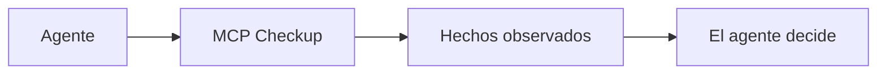

<h1 align="center">MCP Checkup</h1>

<p align="center"><strong>Mira antes de que tu agente se conecte.</strong></p>

<p align="center">
  <a href="https://github.com/mcpcheckup/.github/blob/main/profile/README.md">English</a>
  · <a href="https://github.com/mcpcheckup/.github/blob/main/profile/README.zh-CN.md">简体中文</a>
  · <a href="https://github.com/mcpcheckup/.github/blob/main/profile/README.zh-TW.md">繁體中文</a>
  · <a href="https://github.com/mcpcheckup/.github/blob/main/profile/README.de.md">Deutsch</a>
  · <a href="https://github.com/mcpcheckup/.github/blob/main/profile/README.ja.md">日本語</a>
  · <strong>Español</strong>
  · <a href="https://github.com/mcpcheckup/.github/blob/main/profile/README.fr.md">Français</a>
</p>

<p align="center">
  <a href="https://mcpcheckup.com/mcp"></a>
  <a href="https://github.com/mcpcheckup/checks#use-mcp-checkup-from-your-agent"></a>
  <a href="https://github.com/mcpcheckup/checks/blob/main/LICENSE"></a>
  <a href="https://github.com/mcpcheckup/preflight/blob/main/LICENSE"></a>
</p>

MCP Checkup observa servidores MCP públicos y publica lo que vio una ejecución: si el endpoint respondió, qué revisión del protocolo habló, las huellas de los nombres de tools y del `inputSchema` de cada uno, los metadatos de autenticación observables sin credenciales y las señales de higiene en nombres y descripciones. Una ejecución firmada es una atestación que puedes comprobar tú mismo. Una ejecución sin firma se muestra como observación sin firmar.

Hechos, no veredictos. Cada comprobación cae en exactamente uno de `VERIFIED`, `FAILED`, `OBSERVED_RISK` o `UNVERIFIED`. No se combinan en una puntuación ni en un veredicto, una comprobación que no se ejecutó nunca se presenta como superada, y el resultado no es una barrera para la conexión. Decide el agente.

- Directorio: [mcpcheckup.com/servers](https://mcpcheckup.com/servers)
- Endpoint MCP, Streamable HTTP, sin cuenta y sin clave de API: `https://mcpcheckup.com/mcp`
- MCP Registry oficial: `com.mcpcheckup/mcp`
- También aparece en el [Claude Connectors Directory](https://claude.ai/directory/connectors/mcp-checkup) como conector de la comunidad, en [MCP Collection](https://mcpcollection.com/server/mcp-checkup) y en el [ToolSDK MCP Registry](https://toolsdk-ai.github.io/toolsdk-mcp-registry/#%40toolsdk-remote%2Fmcpcheckup)

## Qué queda registrado

La suite son 15 comprobaciones contra el propio protocolo. La tabla es el resumen. Las definiciones, la semántica de fallo y el presupuesto de la sonda están en [`checks.json`](https://github.com/mcpcheckup/checks/blob/main/packages/checks/checks.json) y en la página de [metodología](https://mcpcheckup.com/methodology).

| Comprobación | Qué registra una ejecución |
| --- | --- |
| `reachability` | Si el endpoint devolvió una respuesta dentro del presupuesto de la sonda. Quedarse fuera de ese presupuesto es `UNVERIFIED`, no `FAILED`. |
| `latency_profile` | p50 y p95 de las peticiones que la sonda cronometró. `VERIFIED` significa que se midió un tiempo. No hay umbral de velocidad ni clasificación. |
| `transport_type` | Si el handshake obtuvo respuesta por el transporte que usó la sonda. |
| `protocol_revision` | Si se identificó una revisión del protocolo conocida. No afirma que esa revisión esté implementada por completo. |
| `discovery_handshake` | Si `server/discover`, o el handshake heredado `initialize`, coincide con la revisión identificada. |
| `tools_list` | Si `tools/list` devuelve una lista de tools estructuralmente válida. Nunca se llaman tools de negocio. |
| `error_taxonomy` | Cuando se envía la llamada reservada, si el error tiene la forma del protocolo. Una desviación es `OBSERVED_RISK`. |
| `tls_certificate` | Si el certificado es válido, no está caducado, coincide el nombre y la cadena está completa. No afirma que el servidor sea seguro. |
| `redirect_policy` | Si una redirección cruzó a otro host. Una redirección entre hosts es `OBSERVED_RISK`. |
| `auth_metadata` | Si los metadatos de autenticación observables en público, o un desafío visto sin credenciales, están bien formados. Una estructura inválida es `OBSERVED_RISK`. Si no hay nada que observar, la comprobación queda en `UNVERIFIED`. Esto no prueba si la autenticación se aplica de verdad. La sonda nunca envía credenciales. |
| `tool_description_hygiene` | Señales en nombres y descripciones de tools, incluidos caracteres ocultos y texto dirigido al agente. Un hallazgo es `OBSERVED_RISK`, no un juicio sobre la intención. |
| `toolset_fingerprint` | SHA-256 de los nombres de tools. `VERIFIED` significa que la huella se pudo calcular, no que la lista siga igual. |
| `schema_fingerprint` | SHA-256 del `inputSchema` de cada tool. Calculable, no «sin cambios». Una descripción modificada no mueve ninguna de las dos huellas. |
| `toolset_unchanged_vs_approved` | Si los nombres de tools coinciden con una línea base aprobada. Sin línea base, permanece en `UNVERIFIED`. |
| `schema_unchanged_vs_approved` | Si cada `inputSchema` coincide con una línea base aprobada. Sin línea base, permanece en `UNVERIFIED`. |

Los cambios de nombre, de parámetros y de descripción se comparan tool por tool en [`packages/toolset-diff`](https://github.com/mcpcheckup/checks/tree/main/packages/toolset-diff) y aparecen en `get_mcp_history`.

## Cómo funciona

Los endpoints públicos que figuran en registros MCP, más un conjunto corto elegido a mano, se comprueban sin que el operador se registre. Los servidores que nadie ha reclamado se vuelven a comprobar cada 12 horas. La página de informe de un servidor reclamado muestra el ciclo en el que está.

Una ejecución lee lo que se ve desde fuera. No audita el código fuente, no llama tools de negocio y no envía credenciales. Para un camino de error llama un nombre de tool reservado, elegido para que no exista. Esa llamada se omite si el nombre ya está en la lista, si la lista no se puede leer entera o si el servidor pide credenciales.

Las huellas de los nombres y del `inputSchema` son SHA-256 sobre la proyección `nfc-jcs/v1`: Unicode NFC y después el JSON Canonicalization Scheme de RFC 8785. La metodología aclara que esa forma combinada no es en sí RFC 8785, porque la especificación prohíbe el paso de normalización. Solo entran los campos proyectados: un campo nuevo al lado no mueve la huella, y un cambio de descripción tampoco.

Una ejecución firmada nombra el commit de la suite y un `suite_digest` sobre `packages/checks`, en un sobre DSSE firmado con Ed25519. Las claves públicas están en [`mcpcheckup.com/.well-known/mcpcheckup-keys.json`](https://mcpcheckup.com/.well-known/mcpcheckup-keys.json), y hay una copia en [`checks`](https://github.com/mcpcheckup/checks/blob/main/keys/mcpcheckup-keys.json). Una ejecución sin firma es una observación sin firmar: lo que se vio, sin conclusión de aprobado o reprobado. Firmar funciona igual haya o no haya alguien que haya reclamado el servidor.

La sonda envía `MCPCheckup-Probe/1.0 (+https://mcpcheckup.com/probe)`. Esa página documenta el presupuesto de peticiones y cómo optar por no participar.



MCP Checkup devuelve los hechos. No puntúa el servidor y no decide si el agente se conecta.

## Cuatro estados, ninguna puntuación

| Estado | Significado |
| --- | --- |
| `VERIFIED` | La comprobación se ejecutó contra este endpoint, en esta pasada, y la afirmación se sostuvo. |
| `FAILED` | La comprobación se ejecutó y la afirmación no se sostuvo. |
| `OBSERVED_RISK` | Se observó una señal. No es un veredicto de aprobado o reprobado. |
| `UNVERIFIED` | Esta comprobación no llegó a un resultado en esta pasada, y el motivo consta. `UNVERIFIED` nunca se trata como un aprobado. |

El estado de ejecución (`completed`, `errored`, `skipped`, `blocked`) se anota aparte de estos cuatro estados y nunca se pliega a un recuento de aprobados.

## Por qué una lista de tools envejece

Aprobar un servidor es aprobar los tools que ofrecía ese día. Después puede añadir, quitar o renombrar un tool, cambiar un `inputSchema` o reescribir una descripción. A un cambio silencioso de ese tipo se le llama rug pull.

MCP Checkup no etiqueta un servidor como rug pull. Registra la diferencia.

- `toolset_fingerprint` son los nombres de los tools. `schema_fingerprint` es cada `inputSchema`. Una huella no dice si algo es bueno o malo. Es un valor que cualquiera puede volver a calcular.
- `get_mcp_history` enumera cambios recientes de nombres, parámetros y descripciones.
- Una diferencia es `FAILED` solo frente a una línea base que alguien aprobó: `toolset_unchanged_vs_approved` y `schema_unchanged_vs_approved`. La metodología llama a `schema_unchanged_vs_approved` la comprobación más directa contra un rug pull. Sin línea base, ambas siguen en `UNVERIFIED` y el cambio es solo un hecho registrado. En un servidor no reclamado, `schema_unchanged_vs_approved` solo puede ser `UNVERIFIED`.

Un informe limpio registra qué se comprobó y qué se vio entonces. No garantiza cómo se comporta el endpoint entre una ejecución y la siguiente.

## Puesta en marcha

Sin cuenta de MCP Checkup y sin clave de API. Los seis tools están documentados en [mcpcheckup.com/agents](https://mcpcheckup.com/agents).

### Claude Code

El plugin preflight lleva la instrucción de consultar un servidor antes de conectar:

```text
/plugin marketplace add mcpcheckup/preflight
/plugin install mcp-preflight@mcpcheckup
```

Conectar el propio MCP Checkup:

```sh
claude mcp add --transport http mcpcheckup https://mcpcheckup.com/mcp
```

Añade `--scope user` para usarlo en todos los proyectos.

En Claude, abre Customize → Connectors → Browse y busca MCP Checkup. O añade un conector personalizado llamado MCP Checkup, pega `https://mcpcheckup.com/mcp` y deja la autenticación en sin inicio de sesión.

### Cursor

Copia [`.cursor/rules/mcp-preflight.mdc`](https://github.com/mcpcheckup/preflight/blob/main/.cursor/rules/mcp-preflight.mdc) en `.cursor/rules/` de tu repositorio.

`.cursor/mcp.json` para un proyecto, o `~/.cursor/mcp.json` para todos:

```json
{"mcpServers":{"mcpcheckup":{"url":"https://mcpcheckup.com/mcp"}}}
```

### Cualquier cliente MCP

```json
{ "mcpServers": { "mcpcheckup": { "type": "http", "url": "https://mcpcheckup.com/mcp" } } }
```

Streamable HTTP, sin autenticación. Muchos agentes pueden añadirlo solos: dile al tuyo que lea `https://mcpcheckup.com/agents` y añada el servidor MCP Checkup. Esa página tiene la configuración contrastada con la documentación de otros clientes.

### AGENTS.md

Copia el cuerpo de [`AGENTS.md`](https://github.com/mcpcheckup/preflight/blob/main/AGENTS.md) en el `AGENTS.md` de la raíz de tu repositorio. Es la misma instrucción que la regla de Cursor y el plugin de Claude Code. Antes de añadir, recomendar o depurar un servidor MCP, consúltalo. Cuéntale a la persona qué se observó, incluido todo lo que figure como `UNVERIFIED` y por qué. No conviertas el resultado en un juicio sobre el servidor.

## Tools

Cinco de los seis tools responden solo con lo que ya está registrado y no contactan el servidor por el que preguntas. `request_check` es el que sí lo hace.

| Tool | Qué hace |
| --- | --- |
| `check_mcps` | Hechos observados para un `provider/name`, una URL de endpoint o un dominio. Un objetivo desconocido vuelve como `unknown`, no como error. Nunca sondea bajo demanda. |
| `get_mcp_report` | Cada comprobación y su estado, más la lista de tools observada, de un servidor ya seguido. |
| `get_mcp_history` | Cambios recientes de un servidor ya seguido: nombres de tools, parámetros, descripciones y revisión del protocolo. |
| `get_attestation` | El sobre de atestación firmado (DSSE, Ed25519) de la última ejecución de la sonda, cuando existe. Si no hay nada que devolver, el motivo es explícito y no es un error de la tool. |
| `search_mcps` | Servidores seguidos, buscados por nombre y descripción de tool. Cada resumen se genera a partir de nombres de tools observados y es texto de terceros, no confiable. |
| `request_check` | Una observación sin firmar de un endpoint completo `http://` o `https://`. Contacta exactamente ese host, así que pregunta antes a la persona. El resultado no se firma, no se guarda como ejecución y no crea página de informe. La inclusión en el directorio no está garantizada. |

Unas 20 peticiones por minuto y dirección IP, contadas por ubicación de Cloudflare. Una respuesta `429` trae `Retry-After` (60 segundos).

## Repositorios

[`checks`](https://github.com/mcpcheckup/checks) declara Apache License 2.0 en su README. Los dos repositorios públicos incluyen un archivo `LICENSE` de Apache License 2.0.

| Repositorio | Para qué sirve |
| --- | --- |
| [`preflight`](https://github.com/mcpcheckup/preflight) | Una instrucción en tres sitios: un plugin de Claude Code, una regla de Cursor y un fragmento de `AGENTS.md` que piden comprobar un servidor en MCP Checkup antes de conectar. |
| [`checks`](https://github.com/mcpcheckup/checks) | La suite de comprobaciones, el canonicalizador y el esquema de las atestaciones firmadas, un diff del conjunto de tools y un verificador sin conexión. Se publica como instantáneas de un monorepo privado. Aquí no se fusionan pull requests. |

## Comprobar nuestro trabajo sin conexión

Una carga firmada nombra el código que la produjo con `suite_commit` y `suite_digest`. En un clon de [`checks`](https://github.com/mcpcheckup/checks), sustituye `<commit>` por ese `suite_commit`:

```sh
git ls-tree -r -z --full-tree <commit> -- packages/checks | openssl dgst -sha512 -binary | openssl base64 -A
```

Antepone `sha512-` a la salida y compárala con `suite_digest`. El comando solo lee objetos git confirmados, así que los finales de línea y la plataforma no importan. Solo funciona cuando `suite_commit` es un commit de este repositorio público. Una carga cuyo `suite_commit` es anterior a la publicación de esos commits nombra el monorepo privado, y ese digest no se puede recalcular aquí.

Verifica un sobre con Node.js 22.18 o posterior en la línea 22, o con Node.js 24 o posterior. No hay nada que instalar. El verificador no hace ninguna petición de red.

Documento de claves en vivo:

```sh
curl -fsS https://mcpcheckup.com/.well-known/mcpcheckup-keys.json -o keys.json
node packages/verifier/verify-attestation.mjs --envelope <file> --keys keys.json
```

Sin conexión, con la copia del clon:

```sh
node packages/verifier/verify-attestation.mjs --envelope <file> --keys keys/mcpcheckup-keys.json
```

En cada firma comprueba que `keyid` está en el documento, que la clave no está revocada y que `observed_at` cae dentro de `valid_from` y `valid_until`, ambos extremos incluidos. Rechaza un `payloadType` que no conoce. La copia del repositorio se actualiza en la siguiente instantánea, así que hasta entonces el documento en vivo puede ser más reciente. Cualquier otra diferencia se informa en [`SECURITY.md`](https://github.com/mcpcheckup/checks/blob/main/SECURITY.md).

## Para quien mantiene un servidor

Puede que tu servidor ya tenga una página de informe. [mcpcheckup.com/maintainers](https://mcpcheckup.com/maintainers) describe qué cambia al reclamarlo. Demostrar que controlas la dirección es un registro DNS TXT o un archivo `.well-known`. Nunca se piden credenciales.

El directorio es [mcpcheckup.com/servers](https://mcpcheckup.com/servers): lo que cada servidor expone ahora, observado y no declarado por ellos. Busca por nombre, dirección, nombre de tool o descripción.

Una petición con el User-Agent de la sonda se explica en [mcpcheckup.com/probe](https://mcpcheckup.com/probe), incluido el presupuesto de peticiones y cómo optar por no participar.
