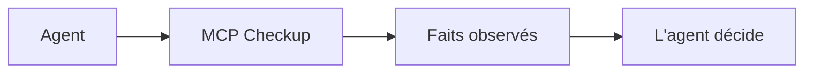

<h1 align="center">MCP Checkup</h1>

<p align="center"><strong>Regardez avant que votre agent ne se connecte.</strong></p>

<p align="center">
  <a href="https://github.com/mcpcheckup/.github/blob/main/profile/README.md">English</a>
  · <a href="https://github.com/mcpcheckup/.github/blob/main/profile/README.zh-CN.md">简体中文</a>
  · <a href="https://github.com/mcpcheckup/.github/blob/main/profile/README.zh-TW.md">繁體中文</a>
  · <a href="https://github.com/mcpcheckup/.github/blob/main/profile/README.de.md">Deutsch</a>
  · <a href="https://github.com/mcpcheckup/.github/blob/main/profile/README.ja.md">日本語</a>
  · <a href="https://github.com/mcpcheckup/.github/blob/main/profile/README.es.md">Español</a>
  · <strong>Français</strong>
</p>

<p align="center">
  <a href="https://mcpcheckup.com/mcp"></a>
  <a href="https://github.com/mcpcheckup/checks#use-mcp-checkup-from-your-agent"></a>
  <a href="https://github.com/mcpcheckup/checks/blob/main/LICENSE"></a>
  <a href="https://github.com/mcpcheckup/preflight/blob/main/LICENSE"></a>
</p>

MCP Checkup observe les serveurs MCP publics et publie ce qu'une exécution a vu : si l'endpoint a répondu, quelle révision du protocole il a indiquée, les empreintes des noms d'outils et du `inputSchema` de chacun, les métadonnées d'authentification observables sans identifiants, et les signaux d'hygiène dans les noms et les descriptions. Une exécution signée est une attestation que vous pouvez vérifier vous-même. Une exécution non signée est présentée comme une observation non signée.

Des faits, pas des verdicts. Chaque contrôle tombe dans exactement un état parmi `VERIFIED`, `FAILED`, `OBSERVED_RISK` et `UNVERIFIED`. Les contrôles ne sont jamais réunis en une note ou un verdict, un contrôle qui n'a pas tourné n'est jamais affiché comme réussi, et le résultat n'est pas un sas devant la connexion. L'agent décide.

- Annuaire : [mcpcheckup.com/servers](https://mcpcheckup.com/servers)
- Endpoint MCP, Streamable HTTP, sans compte et sans clé d'API : `https://mcpcheckup.com/mcp`
- MCP Registry officiel : `com.mcpcheckup/mcp`
- Également listé dans le [Claude Connectors Directory](https://claude.ai/directory/connectors/mcp-checkup) comme connecteur communautaire, sur [MCP Collection](https://mcpcollection.com/server/mcp-checkup) et dans le [ToolSDK MCP Registry](https://toolsdk-ai.github.io/toolsdk-mcp-registry/#%40toolsdk-remote%2Fmcpcheckup)

## Ce qui est enregistré

La suite compte 15 contrôles sur le protocole lui-même. Le tableau est la forme courte. Les définitions, la sémantique d'échec et le budget de la sonde sont dans [`checks.json`](https://github.com/mcpcheckup/checks/blob/main/packages/checks/checks.json) et sur la page de [méthodologie](https://mcpcheckup.com/methodology).

| Contrôle | Ce qu'une exécution enregistre |
| --- | --- |
| `reachability` | Si l'endpoint a renvoyé une réponse dans le budget de la sonde. Dépasser ce budget est `UNVERIFIED`, pas `FAILED`. |
| `latency_profile` | p50 et p95 des requêtes chronométrées par la sonde. `VERIFIED` signifie qu'une durée a été mesurée. Il n'y a ni seuil de vitesse ni classement. |
| `transport_type` | Si la poignée de main a reçu une réponse sur le transport utilisé par la sonde. |
| `protocol_revision` | Si une révision connue du protocole a été identifiée. Ce n'est pas l'affirmation que cette révision est entièrement mise en œuvre. |
| `discovery_handshake` | Si `server/discover`, ou l'ancienne poignée de main `initialize`, correspond à la révision identifiée. |
| `tools_list` | Si `tools/list` renvoie une liste d'outils structurellement valide. Les outils métier ne sont jamais appelés. |
| `error_taxonomy` | Lorsque l'appel réservé est envoyé, si l'erreur a la forme prévue par le protocole. Un écart est `OBSERVED_RISK`. |
| `tls_certificate` | Si le certificat est valide, non expiré, conforme au nom, et si la chaîne est complète. Ce n'est pas une affirmation que le serveur est sûr. |
| `redirect_policy` | Si une redirection a changé d'hôte. Une redirection vers un autre hôte est `OBSERVED_RISK`. |
| `auth_metadata` | Si les métadonnées d'authentification publiquement observables, ou un défi vu sans identifiants, sont bien formés. Une structure invalide est `OBSERVED_RISK`. S'il n'y a rien à observer, le contrôle reste `UNVERIFIED`. Cela ne teste pas si l'authentification est réellement appliquée. La sonde n'envoie jamais d'identifiants. |
| `tool_description_hygiene` | Des signaux dans les noms et descriptions d'outils, dont des caractères cachés et du texte adressé à l'agent. Une occurrence est `OBSERVED_RISK`, pas un jugement d'intention. |
| `toolset_fingerprint` | SHA-256 des noms d'outils. `VERIFIED` signifie que l'empreinte a pu être calculée, pas que la liste est inchangée. |
| `schema_fingerprint` | SHA-256 du `inputSchema` de chaque outil. Calculable, pas « inchangé ». Une description modifiée ne déplace aucune des deux empreintes. |
| `toolset_unchanged_vs_approved` | Si les noms d'outils correspondent à une base approuvée. Sans base, cela reste `UNVERIFIED`. |
| `schema_unchanged_vs_approved` | Si chaque `inputSchema` correspond à une base approuvée. Sans base, cela reste `UNVERIFIED`. |

Les changements de nom, de paramètres et de description sont comparés outil par outil dans [`packages/toolset-diff`](https://github.com/mcpcheckup/checks/tree/main/packages/toolset-diff), et ils apparaissent dans `get_mcp_history`.

## Comment ça se passe

Les endpoints publics listés dans les registres MCP, plus un court ensemble choisi à la main, sont contrôlés sans que l'opérateur s'inscrive. Les serveurs que personne n'a revendiqués sont revus toutes les 12 heures. La page de rapport d'un serveur revendiqué indique le cycle sur lequel il se trouve.

Une exécution lit ce qui est visible de l'extérieur. Elle n'audite pas le code source, n'appelle pas d'outils métier et n'envoie pas d'identifiants. Pour un chemin d'erreur, elle appelle un nom d'outil réservé, choisi pour ne pas exister. Cet appel est omis si le nom est déjà dans la liste, si la liste ne peut pas être lue en entier, ou si le serveur demande des identifiants.

Les empreintes des noms d'outils et des `inputSchema` sont un SHA-256 de la projection `nfc-jcs/v1` : Unicode NFC, puis le JSON Canonicalization Scheme du RFC 8785. La méthodologie précise que cette forme combinée n'est pas elle-même le RFC 8785, parce que la spécification interdit l'étape de normalisation. Seuls les champs projetés comptent : un champ nouveau à côté ne déplace pas l'empreinte, et une description modifiée non plus.

Une exécution signée nomme le commit de la suite de contrôles et un `suite_digest` sur `packages/checks`, dans une enveloppe DSSE signée en Ed25519. Les clés publiques sont publiées sur [`mcpcheckup.com/.well-known/mcpcheckup-keys.json`](https://mcpcheckup.com/.well-known/mcpcheckup-keys.json), et une copie est conservée dans [`checks`](https://github.com/mcpcheckup/checks/blob/main/keys/mcpcheckup-keys.json). Une exécution non signée est une observation non signée : ce qui a été vu, sans conclusion de réussite ou d'échec. La signature fonctionne de la même façon, que quelqu'un ait revendiqué le serveur ou non.

La sonde envoie `MCPCheckup-Probe/1.0 (+https://mcpcheckup.com/probe)`. Cette page documente le budget de requêtes et la façon de se retirer.



MCP Checkup renvoie les faits. Il ne note pas le serveur et ne décide pas si l'agent se connecte.

## Quatre états, pas de note

| État | Sens |
| --- | --- |
| `VERIFIED` | Le contrôle a tourné contre cet endpoint, lors de cette exécution, et l'assertion tenait. |
| `FAILED` | Le contrôle a tourné, et l'assertion ne tenait pas. |
| `OBSERVED_RISK` | Un signal a été observé. Ce n'est pas un verdict de réussite ou d'échec. |
| `UNVERIFIED` | Ce contrôle n'a pas abouti lors de cette exécution, et la raison est indiquée. `UNVERIFIED` n'est jamais traité comme une réussite. |

Le statut d'exécution (`completed`, `errored`, `skipped`, `blocked`) est suivi à part de ces quatre états et n'est jamais ramené à un décompte de réussites.

## Pourquoi une liste d'outils vieillit

Approuver un serveur, c'est approuver les outils qu'il offrait ce jour-là. Ensuite, il peut ajouter, retirer ou renommer un outil, modifier un `inputSchema` ou réécrire une description. Un remplacement discret de ce genre, c'est ce qu'on appelle un rug pull.

MCP Checkup n'étiquette pas un serveur comme rug pull. Il enregistre la différence.

- `toolset_fingerprint` porte sur les noms d'outils. `schema_fingerprint` porte sur chaque `inputSchema`. Une empreinte ne dit rien du bien ou du mal. C'est une valeur que n'importe qui peut recalculer.
- `get_mcp_history` liste les changements récents de noms, de paramètres et de descriptions.
- Une différence n'est `FAILED` que face à une base que quelqu'un a approuvée : `toolset_unchanged_vs_approved` et `schema_unchanged_vs_approved`. La méthodologie appelle `schema_unchanged_vs_approved` le contrôle le plus direct contre un rug pull. Sans base, les deux restent `UNVERIFIED`, et le changement n'est qu'un fait enregistré. Sur un serveur non revendiqué, `schema_unchanged_vs_approved` ne peut être que `UNVERIFIED`.

Un rapport propre enregistre ce qui a été contrôlé et ce qui a été vu à ce moment-là. Il ne garantit pas le comportement de l'endpoint entre deux exécutions.

## Démarrage

Pas de compte MCP Checkup, pas de clé d'API. Les six outils sont documentés sur [mcpcheckup.com/agents](https://mcpcheckup.com/agents).

### Claude Code

Le plugin preflight porte l'instruction de consulter un serveur avant de s'y connecter :

```text
/plugin marketplace add mcpcheckup/preflight
/plugin install mcp-preflight@mcpcheckup
```

Connecter MCP Checkup lui-même :

```sh
claude mcp add --transport http mcpcheckup https://mcpcheckup.com/mcp
```

Ajoutez `--scope user` pour l'utiliser dans chaque projet.

Dans Claude, ouvrez Customize → Connectors → Browse et cherchez MCP Checkup. Ou ajoutez un connecteur personnalisé nommé MCP Checkup, collez `https://mcpcheckup.com/mcp`, et réglez l'authentification sur sans identification.

### Cursor

Copiez [`.cursor/rules/mcp-preflight.mdc`](https://github.com/mcpcheckup/preflight/blob/main/.cursor/rules/mcp-preflight.mdc) dans `.cursor/rules/` de votre dépôt.

`.cursor/mcp.json` pour un projet, ou `~/.cursor/mcp.json` pour tous :

```json
{"mcpServers":{"mcpcheckup":{"url":"https://mcpcheckup.com/mcp"}}}
```

### N'importe quel client MCP

```json
{ "mcpServers": { "mcpcheckup": { "type": "http", "url": "https://mcpcheckup.com/mcp" } } }
```

Streamable HTTP, sans authentification. Beaucoup d'agents peuvent l'ajouter eux-mêmes : dites au vôtre de lire `https://mcpcheckup.com/agents` et d'ajouter le serveur MCP Checkup. Cette page donne la configuration, vérifiée contre la documentation des autres clients.

### AGENTS.md

Copiez le corps de [`AGENTS.md`](https://github.com/mcpcheckup/preflight/blob/main/AGENTS.md) dans le `AGENTS.md` à la racine de votre dépôt. C'est la même instruction que la règle Cursor et le plugin Claude Code. Avant d'ajouter, de recommander ou de déboguer un serveur MCP, consultez-le. Dites à la personne ce qui a été observé, y compris tout ce qui est `UNVERIFIED` et pourquoi. Ne transformez pas le résultat en jugement sur le serveur.

## Outils

Cinq des six outils ne répondent qu'à partir de ce qui est déjà suivi, et ne contactent pas le serveur dont vous parlez. `request_check` est celui qui le contacte.

| Outil | Ce qu'il fait |
| --- | --- |
| `check_mcps` | Faits observés pour un `provider/name`, une URL d'endpoint ou un domaine. Une cible inconnue revient en `unknown`, pas en erreur. Il ne sonde jamais à la demande. |
| `get_mcp_report` | Chaque contrôle et son état, plus la liste d'outils observée, pour un serveur déjà suivi. |
| `get_mcp_history` | Changements récents d'un serveur déjà suivi : noms d'outils, paramètres, descriptions et révision du protocole. |
| `get_attestation` | L'enveloppe d'attestation signée (DSSE, Ed25519) de la dernière exécution de la sonde, lorsqu'il y en a une. Sinon la raison est explicite, et ce n'est pas une erreur d'outil. |
| `search_mcps` | Serveurs suivis, retrouvés par nom et description d'outil. Chaque résumé est produit à partir des noms d'outils observés et constitue un texte tiers non fiable. |
| `request_check` | Une observation non signée d'un endpoint complet en `http://` ou `https://`. Il contacte exactement cet hôte : demandez d'abord à la personne. Le résultat n'est pas signé, n'est pas stocké comme exécution et ne crée pas de page de rapport. L'inclusion dans l'annuaire n'est pas garantie. |

Environ 20 requêtes par minute et par adresse IP, comptées par site Cloudflare. Une réponse `429` porte `Retry-After` (60 secondes).

## Dépôts

[`checks`](https://github.com/mcpcheckup/checks) indique Apache License 2.0 dans son README. Les deux dépôts publics livrent un fichier `LICENSE` sous Apache License 2.0.

| Dépôt | À quoi il sert |
| --- | --- |
| [`preflight`](https://github.com/mcpcheckup/preflight) | Une instruction à trois endroits : un plugin Claude Code, une règle Cursor et un extrait `AGENTS.md`, qui demandent de contrôler un serveur sur MCP Checkup avant de s'y connecter. |
| [`checks`](https://github.com/mcpcheckup/checks) | La suite de contrôles, le canonicaliseur et le schéma des attestations signées, un diff du jeu d'outils et un vérificateur hors ligne. Publié comme instantanés d'un monorepo privé. Les pull requests n'y sont pas fusionnées. |

## Vérifier notre travail hors ligne

Une charge utile signée nomme le code qui l'a produite par `suite_commit` et `suite_digest`. Dans un clone de [`checks`](https://github.com/mcpcheckup/checks), remplacez `<commit>` par ce `suite_commit` :

```sh
git ls-tree -r -z --full-tree <commit> -- packages/checks | openssl dgst -sha512 -binary | openssl base64 -A
```

Préfixez la sortie par `sha512-` et comparez-la à `suite_digest`. La commande ne lit que des objets git commités : les fins de ligne et la plateforme n'interviennent pas. Cela ne fonctionne que si `suite_commit` est un commit de ce dépôt public. Une charge dont le `suite_commit` date d'avant la publication de ces commits désigne le monorepo privé, et ce digest ne peut pas être recalculé ici.

Vérifiez une enveloppe avec Node.js 22.18 ou plus récent sur la ligne 22, ou avec Node.js 24 ou plus récent. Rien à installer. Le vérificateur lui-même ne fait aucune requête réseau.

Document de clés en ligne :

```sh
curl -fsS https://mcpcheckup.com/.well-known/mcpcheckup-keys.json -o keys.json
node packages/verifier/verify-attestation.mjs --envelope <file> --keys keys.json
```

Hors ligne, avec la copie du clone :

```sh
node packages/verifier/verify-attestation.mjs --envelope <file> --keys keys/mcpcheckup-keys.json
```

Pour chaque signature, il vérifie que `keyid` figure dans le document, que la clé n'est pas révoquée, et que `observed_at` se trouve dans `valid_from` et `valid_until`, bornes incluses. Il refuse un `payloadType` qu'il ne connaît pas. La copie du dépôt est mise à jour au snapshot suivant : jusque-là, le document en ligne peut être plus récent. Toute autre différence se signale dans [`SECURITY.md`](https://github.com/mcpcheckup/checks/blob/main/SECURITY.md).

## Mainteneurs

Votre serveur a peut-être déjà une page de rapport. [mcpcheckup.com/maintainers](https://mcpcheckup.com/maintainers) décrit ce que change une revendication. Prouver que vous contrôlez l'adresse se fait par un enregistrement DNS TXT ou un fichier `.well-known`. Des identifiants ne sont jamais demandés.

L'annuaire est [mcpcheckup.com/servers](https://mcpcheckup.com/servers) : ce que chaque serveur expose maintenant, observé plutôt que déclaré. Recherche par nom, adresse, nom d'outil ou description.

Une requête portant le User-Agent de la sonde est expliquée sur [mcpcheckup.com/probe](https://mcpcheckup.com/probe), budget de requêtes et retrait compris.
