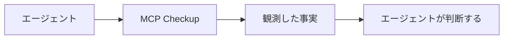

<h1 align="center">MCP Checkup</h1>

<p align="center"><strong>エージェントが接続する前に、見ておく。</strong></p>

<p align="center">
  <a href="https://github.com/mcpcheckup/.github/blob/main/profile/README.md">English</a>
  · <a href="https://github.com/mcpcheckup/.github/blob/main/profile/README.zh-CN.md">简体中文</a>
  · <a href="https://github.com/mcpcheckup/.github/blob/main/profile/README.zh-TW.md">繁體中文</a>
  · <a href="https://github.com/mcpcheckup/.github/blob/main/profile/README.de.md">Deutsch</a>
  · <strong>日本語</strong>
  · <a href="https://github.com/mcpcheckup/.github/blob/main/profile/README.es.md">Español</a>
  · <a href="https://github.com/mcpcheckup/.github/blob/main/profile/README.fr.md">Français</a>
</p>

<p align="center">
  <a href="https://mcpcheckup.com/mcp"></a>
  <a href="https://github.com/mcpcheckup/checks#use-mcp-checkup-from-your-agent"></a>
  <a href="https://github.com/mcpcheckup/checks/blob/main/LICENSE"></a>
  <a href="https://github.com/mcpcheckup/preflight/blob/main/LICENSE"></a>
</p>

MCP Checkup は公開 MCP サーバーを観測し、1 回の実行で見えたことを公開します。エンドポイントが応答したか、どのプロトコル改訂を話したか、ツール名と各ツールの `inputSchema` のフィンガープリント、資格情報なしで見える認証メタデータ、ツール名と説明に含まれる衛生上のシグナルです。署名された実行は、自分で検証できるアテステーションです。署名されていない実行は、未署名の観測として示されます。

事実を記録し、判定はしません。各チェックは `VERIFIED`、`FAILED`、`OBSERVED_RISK`、`UNVERIFIED` のいずれかちょうど 1 つに落ちます。チェックを点数や判定にまとめることはなく、実行されなかったチェックが合格として示されることもなく、結果は接続の可否を決める門にもなりません。決めるのはエージェントです。

- ディレクトリ: [mcpcheckup.com/servers](https://mcpcheckup.com/servers)
- MCP エンドポイント。Streamable HTTP。アカウントも API キーも不要: `https://mcpcheckup.com/mcp`
- 公式 MCP Registry: `com.mcpcheckup/mcp`
- [Claude Connectors Directory](https://claude.ai/directory/connectors/mcp-checkup) にコミュニティコネクタとして掲載。ほかに [MCP Collection](https://mcpcollection.com/server/mcp-checkup) と [ToolSDK MCP Registry](https://toolsdk-ai.github.io/toolsdk-mcp-registry/#%40toolsdk-remote%2Fmcpcheckup)

## 何を記録するか

スイートはプロトコル自体に対する 15 項目です。下の表は要約です。定義、失敗の意味、プローブの予算は [`checks.json`](https://github.com/mcpcheckup/checks/blob/main/packages/checks/checks.json) と[方法論](https://mcpcheckup.com/methodology)のページにあります。

| チェック | 1 回の実行が記録するもの |
| --- | --- |
| `reachability` | エンドポイントがプローブの予算内で応答を返したか。予算を超えた場合は `FAILED` ではなく `UNVERIFIED`。 |
| `latency_profile` | プローブが計時したリクエストの p50 と p95。`VERIFIED` は時間が測れたという意味です。速さの閾値も順位もありません。 |
| `transport_type` | プローブが使ったトランスポート上でハンドシェイクに応答があったか。 |
| `protocol_revision` | 認識済みのプロトコル改訂を特定できたか。その改訂を完全に実装している、という主張ではありません。 |
| `discovery_handshake` | `server/discover`、または従来の `initialize` ハンドシェイクが、特定された改訂に合っているか。 |
| `tools_list` | `tools/list` が構造的に妥当なツール一覧を返すか。業務ツールは呼び出しません。 |
| `error_taxonomy` | 予約された呼び出しを送ったとき、エラーの形がプロトコルに合っているか。ずれは `OBSERVED_RISK`。 |
| `tls_certificate` | 証明書が有効で、期限切れでなく、名前が一致し、チェーンが揃っているか。サーバーが安全だという宣言ではありません。 |
| `redirect_policy` | リダイレクトが別のホストへ越えたか。ホストをまたぐリダイレクトは `OBSERVED_RISK`。 |
| `auth_metadata` | 公開して観測できる認証メタデータ、または資格情報なしで見えたチャレンジの構造が整っているか。構造が不正なら `OBSERVED_RISK`。何も観測できなければ `UNVERIFIED`。認証が実際に強制されているかは調べません。プローブは資格情報を送りません。 |
| `tool_description_hygiene` | ツール名と説明の中のシグナル。不可視文字や、エージェントに向けた文を含みます。該当は `OBSERVED_RISK` であり、意図の判断ではありません。 |
| `toolset_fingerprint` | ツール名の SHA-256。`VERIFIED` はフィンガープリントを計算できたという意味で、一覧が変わっていないという意味ではありません。 |
| `schema_fingerprint` | 各ツールの `inputSchema` の SHA-256。計算できたかどうかだけを見ます。説明が変わっても、どちらのフィンガープリントも動きません。 |
| `toolset_unchanged_vs_approved` | ツール名が承認済みベースラインと一致するか。ベースラインがなければ `UNVERIFIED` のままです。 |
| `schema_unchanged_vs_approved` | 各 `inputSchema` が承認済みベースラインと一致するか。ベースラインがなければ `UNVERIFIED` のままです。 |

名前、パラメータ、説明の変化は [`packages/toolset-diff`](https://github.com/mcpcheckup/checks/tree/main/packages/toolset-diff) がツールごとに比較し、`get_mcp_history` にも出ます。

## 仕組み

MCP レジストリに載っている公開エンドポイントと、少数の手選びのサーバーは、運営者が申し込まなくても検査されます。運営者がまだ申告していないサーバーは 12 時間ごとに再検査します。申告済みサーバーのレポートページには、そのサーバーの周期が出ます。

1 回の実行は、外から見えるものだけを読みます。ソースは監査せず、業務ツールは呼ばず、資格情報は送りません。エラー経路のために、存在しないはずの予約済みツール名を 1 つ呼びます。一覧にその名前が既にある、一覧を最後まで読めない、サーバーが資格情報を求めた、のいずれかのときはその呼び出しを省きます。

ツール名と `inputSchema` のフィンガープリントは、投影 `nfc-jcs/v1` に対する SHA-256 です。Unicode NFC のあと、RFC 8785 の JSON Canonicalization Scheme を適用します。方法論にあるとおり、この組み合わせ自体は RFC 8785 ではありません。仕様が正規化の追加を禁じているためです。指紋が覆うのは投影したフィールドだけなので、隣に新しいフィールドが増えてもフィンガープリントは動かず、説明が変わっても動きません。

署名された実行は、チェックスイートのコミットと、`packages/checks` に対する `suite_digest` を、Ed25519 で署名した DSSE エンベロープに載せます。公開鍵は [`mcpcheckup.com/.well-known/mcpcheckup-keys.json`](https://mcpcheckup.com/.well-known/mcpcheckup-keys.json) にあり、写しが [`checks`](https://github.com/mcpcheckup/checks/blob/main/keys/mcpcheckup-keys.json) にあります。署名されていない実行は未署名の観測です。見えたことを書くだけで、合格か不合格かの結論は付きません。誰かがサーバーを申告しているかどうかで、署名の扱いが変わることはありません。

プローブが送る User-Agent は `MCPCheckup-Probe/1.0 (+https://mcpcheckup.com/probe)` です。リクエスト予算とオプトアウトの手順はそのページにあります。



MCP Checkup が返すのは事実です。サーバーに点数は付けず、エージェントが接続するかどうかも決めません。

## 4 つの状態。点数はない

| 状態 | 意味 |
| --- | --- |
| `VERIFIED` | この実行で、このエンドポイントに対してチェックが走り、表明が成り立った。 |
| `FAILED` | チェックは走り、表明は成り立たなかった。 |
| `OBSERVED_RISK` | シグナルを観測した。合格か不合格かの判定ではない。 |
| `UNVERIFIED` | この実行ではこのチェックが結果に到達せず、理由が書かれている。`UNVERIFIED` を合格としては扱いません。 |

実行状態（`completed`、`errored`、`skipped`、`blocked`）はこれら 4 状態とは別に記録され、合格数には折り込みません。

## ツール一覧が古くなる理由

サーバーを承認するということは、その日に提供されていたツールを承認するということです。その後、ツールの追加、削除、改名、`inputSchema` の変更、説明の書き換えが起こり得ます。断りなく入れ替わるこの種の変化を、rug pull と呼びます。

MCP Checkup はサーバーを rug pull とはラベルしません。差分を記録します。

- `toolset_fingerprint` はツール名、`schema_fingerprint` は各 `inputSchema` です。フィンガープリント自体は良し悪しを言いません。誰でも再計算できる値です。
- `get_mcp_history` は、名前、パラメータ、説明の最近の変化を列挙します。
- 差分が `FAILED` になるのは、誰かが承認したベースラインと食い違ったときだけです。対象は `toolset_unchanged_vs_approved` と `schema_unchanged_vs_approved` です。方法論は `schema_unchanged_vs_approved` を、rug pull に対する最も直接的なチェックと呼んでいます。ベースラインがなければ両方とも `UNVERIFIED` のままで、変化は記録された事実にすぎません。未申告のサーバーでは、`schema_unchanged_vs_approved` は `UNVERIFIED` にしかなりません。

きれいなレポートは、そのとき何を検査し、何が見えたかの記録です。実行と実行のあいだのエンドポイントの挙動を保証するものではありません。

## はじめに

MCP Checkup のアカウントも API キーも要りません。6 つのツールは [mcpcheckup.com/agents](https://mcpcheckup.com/agents) に書いてあります。

### Claude Code

preflight プラグインは、接続前にサーバーを調べるという指示を運びます。

```text
/plugin marketplace add mcpcheckup/preflight
/plugin install mcp-preflight@mcpcheckup
```

MCP Checkup 自体を接続する:

```sh
claude mcp add --transport http mcpcheckup https://mcpcheckup.com/mcp
```

すべてのプロジェクトで使うには `--scope user` を付けます。

Claude では Customize → Connectors → Browse を開き、MCP Checkup を検索します。カスタムコネクタとして名前を MCP Checkup にし、`https://mcpcheckup.com/mcp` を貼り付け、認証をサインインなしにしても構いません。

### Cursor

[`.cursor/rules/mcp-preflight.mdc`](https://github.com/mcpcheckup/preflight/blob/main/.cursor/rules/mcp-preflight.mdc) を、自分のリポジトリの `.cursor/rules/` にコピーします。

1 つのプロジェクトなら `.cursor/mcp.json`、すべてのプロジェクトなら `~/.cursor/mcp.json` です。

```json
{"mcpServers":{"mcpcheckup":{"url":"https://mcpcheckup.com/mcp"}}}
```

### どの MCP クライアントでも

```json
{ "mcpServers": { "mcpcheckup": { "type": "http", "url": "https://mcpcheckup.com/mcp" } } }
```

Streamable HTTP で、認証は不要です。多くのエージェントは自分で追加できます。`https://mcpcheckup.com/agents` を読んで MCP Checkup サーバーを足すよう伝えてください。他のクライアントのドキュメントと突き合わせた手順もそのページにあります。

### AGENTS.md

[`AGENTS.md`](https://github.com/mcpcheckup/preflight/blob/main/AGENTS.md) の本文を、リポジトリ直下の `AGENTS.md` にコピーします。Cursor ルールおよび Claude Code プラグインと同じ指示です。MCP サーバーを追加、推奨、デバッグする前に調べます。観測した内容を、`UNVERIFIED` とその理由も含めて人に伝えます。結果を、そのサーバーについての判断に変えないでください。

## ツール

6 つのうち 5 つは、既に追跡している内容だけから答え、尋ねたサーバーには接触しません。接触するのは `request_check` だけです。

| ツール | すること |
| --- | --- |
| `check_mcps` | `provider/name`、エンドポイント URL、またはドメインについて観測済みの事実を返す。未追跡の対象はエラーではなく `unknown`。オンデマンドでは探査しません。 |
| `get_mcp_report` | 追跡済みサーバー 1 台について、各チェックとその状態、および観測したツール一覧。 |
| `get_mcp_history` | 追跡済みサーバー 1 台の最近の変化。ツール名、パラメータ、説明、プロトコル改訂。 |
| `get_attestation` | 最新のプローブ実行に署名付きアテステーションのエンベロープ（DSSE、Ed25519）があるとき、それを返す。返せないときは理由が明示され、ツールエラーにはなりません。 |
| `search_mcps` | ツール名と説明で追跡済みサーバーを探す。各要約は観測したツール名から生成された、信頼できない第三者のテキストです。 |
| `request_check` | `http://` または `https://` の完全なエンドポイントを、署名なしで 1 回観測する。接触するのはそのホストだけなので、先に人へ確認する。結果は署名されず、実行としても保存されず、レポートページも作られない。ディレクトリへの収録は保証されません。 |

IP アドレスあたり毎分おおよそ 20 リクエストで、Cloudflare のロケーションごとに数えます。`429` 応答には `Retry-After`（60 秒）が付きます。

## リポジトリ

[`checks`](https://github.com/mcpcheckup/checks) の README は Apache License 2.0 と記しています。公開リポジトリはどちらも Apache License 2.0 の `LICENSE` ファイルを含みます。

| リポジトリ | 役割 |
| --- | --- |
| [`preflight`](https://github.com/mcpcheckup/preflight) | 同じ指示が 3 か所にある。Claude Code プラグイン、Cursor ルール、`AGENTS.md` の断片。いずれも、接続前に MCP Checkup でサーバーを調べるよう伝えます。 |
| [`checks`](https://github.com/mcpcheckup/checks) | チェックスイート、署名付きアテステーションの正規化器とスキーマ、ツールセットの差分、オフライン検証器。非公開モノレポのスナップショットとして公開されています。このリポジトリでは pull request はマージされません。 |

## オフラインでこちら側の作業を検証する

署名されたペイロードは、それを作ったコードを `suite_commit` と `suite_digest` で名指しします。[`checks`](https://github.com/mcpcheckup/checks) のクローンで、`<commit>` をその `suite_commit` に置き換えます。

```sh
git ls-tree -r -z --full-tree <commit> -- packages/checks | openssl dgst -sha512 -binary | openssl base64 -A
```

出力の前に `sha512-` を付け、`suite_digest` と比べます。コマンドが読むのはコミット済みの git オブジェクトだけなので、改行やプラットフォームには左右されません。`suite_commit` がこの公開リポジトリのコミットであるときに限り計算できます。公開より前の `suite_commit` を持つペイロードは非公開モノレポを指しており、そのダイジェストはここでは再計算できません。

エンベロープの検証には、22 系なら Node.js 22.18 以降、または Node.js 24 以降が必要です。インストール作業はありません。検証器自身はネットワーク要求を出しません。

公開中の鍵ドキュメント:

```sh
curl -fsS https://mcpcheckup.com/.well-known/mcpcheckup-keys.json -o keys.json
node packages/verifier/verify-attestation.mjs --envelope <file> --keys keys.json
```

オフラインでは、クローン内の写しを使います。

```sh
node packages/verifier/verify-attestation.mjs --envelope <file> --keys keys/mcpcheckup-keys.json
```

各署名について、`keyid` がドキュメントにあり、鍵が失効しておらず、`observed_at` が `valid_from` と `valid_until` の内側（両端を含む）にあることを確認します。知らない `payloadType` は拒否します。リポジトリ内の写しは次のスナップショットで更新されるため、それまでは公開中のドキュメントの方が新しいことがあります。それ以外の差異は [`SECURITY.md`](https://github.com/mcpcheckup/checks/blob/main/SECURITY.md) へ。

## メンテナへ

サーバーには、まだ開いていないレポートページがあるかもしれません。申告すると何が変わるかは [mcpcheckup.com/maintainers](https://mcpcheckup.com/maintainers) にあります。アドレスを管理していることの証明は、DNS の TXT レコードか `.well-known` ファイルです。資格情報は求めません。

ディレクトリは [mcpcheckup.com/servers](https://mcpcheckup.com/servers) です。各サーバーが今公開しているものを、自称ではなく観測として並べます。名前、アドレス、ツール名、説明で検索できます。

プローブの User-Agent が付いたリクエストについては、[mcpcheckup.com/probe](https://mcpcheckup.com/probe) がリクエスト予算とオプトアウトを説明しています。
