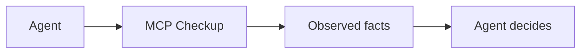

<h1 align="center">MCP Checkup</h1>

<p align="center"><strong>Look before your agent connects.</strong></p>

<p align="center">
  <strong>English</strong>
  · <a href="https://github.com/mcpcheckup/.github/blob/main/profile/README.zh-CN.md">简体中文</a>
  · <a href="https://github.com/mcpcheckup/.github/blob/main/profile/README.zh-TW.md">繁體中文</a>
  · <a href="https://github.com/mcpcheckup/.github/blob/main/profile/README.de.md">Deutsch</a>
  · <a href="https://github.com/mcpcheckup/.github/blob/main/profile/README.ja.md">日本語</a>
  · <a href="https://github.com/mcpcheckup/.github/blob/main/profile/README.es.md">Español</a>
  · <a href="https://github.com/mcpcheckup/.github/blob/main/profile/README.fr.md">Français</a>
</p>

<p align="center">
  <a href="https://mcpcheckup.com/mcp"></a>
  <a href="https://github.com/mcpcheckup/checks#use-mcp-checkup-from-your-agent"></a>
  <a href="https://github.com/mcpcheckup/checks/blob/main/LICENSE"></a>
  <a href="https://github.com/mcpcheckup/preflight/blob/main/LICENSE"></a>
</p>

MCP Checkup watches public MCP servers and publishes what one run observed: whether the endpoint answered, which protocol revision it spoke, fingerprints of the tool names and of each tool's `inputSchema`, publicly observable authentication metadata, and hygiene signals in tool names and descriptions. A signed run is an attestation you can verify yourself. A run that was not signed is shown as an unsigned observation.

Facts, not verdicts. Every check lands in exactly one of `VERIFIED`, `FAILED`, `OBSERVED_RISK`, or `UNVERIFIED`. Checks are never combined into a score or a verdict, a check that did not run is never shown as one that passed, and the result is not a gate on the connection. The agent decides.

- Directory: [mcpcheckup.com/servers](https://mcpcheckup.com/servers)
- MCP endpoint, Streamable HTTP, no account and no API key: `https://mcpcheckup.com/mcp`
- Official MCP Registry: `com.mcpcheckup/mcp`
- Also listed in the [Claude Connectors Directory](https://claude.ai/directory/connectors/mcp-checkup) as a community connector, on [MCP Collection](https://mcpcollection.com/server/mcp-checkup), and in the [ToolSDK MCP Registry](https://toolsdk-ai.github.io/toolsdk-mcp-registry/#%40toolsdk-remote%2Fmcpcheckup)

## What it records

The suite is 15 checks against the protocol. This table is the short form. The definitions, failure semantics, and probe budget live in [`checks.json`](https://github.com/mcpcheckup/checks/blob/main/packages/checks/checks.json) and on the [methodology](https://mcpcheckup.com/methodology) page.

| Check | What a run records |
| --- | --- |
| `reachability` | Whether the endpoint returned a response within the probe budget. Missing that budget is `UNVERIFIED`, not `FAILED`. |
| `latency_profile` | p50 and p95 of the requests the probe timed. `VERIFIED` means a time was measured. There is no speed threshold and no ranking. |
| `transport_type` | Whether the handshake was answered over the transport the probe used. |
| `protocol_revision` | Whether a recognized protocol revision was identified. Not a claim that the revision is fully implemented. |
| `discovery_handshake` | Whether `server/discover`, or the legacy `initialize` handshake, matches the revision that was identified. |
| `tools_list` | Whether `tools/list` returns a structurally valid tool list. Business tools are never called. |
| `error_taxonomy` | When the probe's reserved call is sent, whether the error has the protocol's shape. A deviation is `OBSERVED_RISK`. |
| `tls_certificate` | Whether the certificate is valid, unexpired, name-matched, and fully chained. Not a statement that the server is secure. |
| `redirect_policy` | Whether a redirect crossed to another host. A cross-host redirect is `OBSERVED_RISK`. |
| `auth_metadata` | Whether publicly observable auth metadata, or a challenge seen with no credentials, is well formed. An invalid structure is `OBSERVED_RISK`. If none can be observed, the check is `UNVERIFIED`. This does not test whether authentication is enforced. The probe never sends credentials. |
| `tool_description_hygiene` | Signals in tool names and descriptions, including hidden characters and text aimed at the agent. A hit is `OBSERVED_RISK`, not a judgment of intent. |
| `toolset_fingerprint` | SHA-256 of the tool names. `VERIFIED` means the fingerprint could be computed, not that the list is unchanged. |
| `schema_fingerprint` | SHA-256 of each tool's `inputSchema`. Computable, not "unchanged". A changed description moves neither fingerprint. |
| `toolset_unchanged_vs_approved` | Whether the tool names match an approved baseline. With no baseline, this stays `UNVERIFIED`. |
| `schema_unchanged_vs_approved` | Whether each `inputSchema` matches an approved baseline. With no baseline, this stays `UNVERIFIED`. |

Name, parameter, and description changes are compared tool by tool in [`packages/toolset-diff`](https://github.com/mcpcheckup/checks/tree/main/packages/toolset-diff), and they appear in `get_mcp_history`.

## How it works

Public endpoints listed in MCP registries, plus a short hand-picked set, are checked without the operator signing up. Servers nobody has claimed are re-checked every 12 hours. A claimed server's report page shows the cycle that server is on.

A run reads what is visible from outside. It does not audit source code, it does not call business tools, and it does not send credentials. For an error path it calls one reserved tool name, chosen so the name should not exist. That call is skipped if the list already has the name, if the list cannot be read in full, or if the server asks for credentials.

Tool-name and `inputSchema` fingerprints are SHA-256 over the `nfc-jcs/v1` projection: Unicode NFC, then the JSON Canonicalization Scheme from RFC 8785. The methodology notes that this combined form is not itself RFC 8785, because that specification forbids the normalization step. Only the projected fields are covered, so a new field beside them does not move the fingerprint, and a changed description moves neither one.

A signed run names the check-suite commit and a `suite_digest` over `packages/checks`, in a DSSE envelope signed with Ed25519. Public keys are published at [`mcpcheckup.com/.well-known/mcpcheckup-keys.json`](https://mcpcheckup.com/.well-known/mcpcheckup-keys.json), and a copy is kept in [`checks`](https://github.com/mcpcheckup/checks/blob/main/keys/mcpcheckup-keys.json). A run that was not signed is an unsigned observation: what was seen, with no pass/fail conclusion. Signing works the same whether or not anyone has claimed the server.

The probe sends `MCPCheckup-Probe/1.0 (+https://mcpcheckup.com/probe)`. That page documents the request budget and how to opt out.



MCP Checkup returns the facts. It does not score the server, and it does not decide whether the agent connects.

## Four states, never a score

| State | Meaning |
| --- | --- |
| `VERIFIED` | The check ran against this endpoint, on this run, and the assertion held. |
| `FAILED` | The check ran, and the assertion did not hold. |
| `OBSERVED_RISK` | A signal was observed. It is not a pass/fail verdict. |
| `UNVERIFIED` | This check did not reach a result on this run, and the reason is stated. `UNVERIFIED` is never treated as a pass. |

Execution status (`completed`, `errored`, `skipped`, `blocked`) is tracked separately from these four states and is never folded into a pass count.

## Why a tool list goes stale

Approving a server approves the tools it offered that day. Later it can add, remove, or rename a tool, change an `inputSchema`, or rewrite a description. A quiet swap of that kind is what people call a rug pull.

MCP Checkup does not label a server as a rug pull. It records the difference.

- `toolset_fingerprint` is the tool names. `schema_fingerprint` is each `inputSchema`. A fingerprint says nothing about good or bad. It is a value anyone can recompute.
- `get_mcp_history` lists recent changes to names, parameters, and descriptions.
- A difference is `FAILED` only against a baseline someone approved: `toolset_unchanged_vs_approved` and `schema_unchanged_vs_approved`. The methodology calls `schema_unchanged_vs_approved` the most direct check against a rug pull. With no baseline, both stay `UNVERIFIED`, and the change is only a recorded fact. On an unclaimed server, `schema_unchanged_vs_approved` can only be `UNVERIFIED`.

A clean report records what was checked and what was seen then. It does not guarantee how the endpoint behaves between runs.

## Quick start

No MCP Checkup account, and no API key. The six tools are documented at [mcpcheckup.com/agents](https://mcpcheckup.com/agents).

### Claude Code

The preflight plugin carries the instruction to look a server up before connecting:

```text
/plugin marketplace add mcpcheckup/preflight
/plugin install mcp-preflight@mcpcheckup
```

Connect MCP Checkup itself:

```sh
claude mcp add --transport http mcpcheckup https://mcpcheckup.com/mcp
```

Add `--scope user` to use it in every project.

In Claude, open Customize → Connectors → Browse and search for MCP Checkup. Or add a custom connector named MCP Checkup, paste `https://mcpcheckup.com/mcp`, and set authentication to no sign-in.

### Cursor

Copy [`.cursor/rules/mcp-preflight.mdc`](https://github.com/mcpcheckup/preflight/blob/main/.cursor/rules/mcp-preflight.mdc) into `.cursor/rules/` in your repository.

`.cursor/mcp.json` for one project, or `~/.cursor/mcp.json` for every project:

```json
{"mcpServers":{"mcpcheckup":{"url":"https://mcpcheckup.com/mcp"}}}
```

### Any MCP client

```json
{ "mcpServers": { "mcpcheckup": { "type": "http", "url": "https://mcpcheckup.com/mcp" } } }
```

Streamable HTTP, no authentication. Many agents can add it themselves: tell yours to read `https://mcpcheckup.com/agents` and add the MCP Checkup server. That page has the setup checked against other clients' documentation.

### AGENTS.md

Copy the body of [`AGENTS.md`](https://github.com/mcpcheckup/preflight/blob/main/AGENTS.md) into the `AGENTS.md` at the root of your repository. It is the same instruction as the Cursor rule and the Claude Code plugin. Before adding, recommending, or debugging an MCP server, look it up. Tell the person what was observed, including anything `UNVERIFIED` and why. Do not turn the result into a judgment about the server.

## Tools

Five tools answer only from what is already tracked and never contact the server you ask about. `request_check` is the one that does.

| Tool | What it does |
| --- | --- |
| `check_mcps` | Observed facts for a `provider/name`, an endpoint URL, or a domain. An unknown target comes back as `unknown`, not an error. It never probes on demand. |
| `get_mcp_report` | Every check and its state, plus the observed tool list, for one tracked server. |
| `get_mcp_history` | Recent changes for one tracked server: tool names, parameters, descriptions, and protocol revision. |
| `get_attestation` | The signed attestation envelope (DSSE, Ed25519) for the latest probe run, when one exists. Otherwise the reason is explicit, not an error. |
| `search_mcps` | Tracked servers matched by tool name and description. Each summary is generated from observed tool names and is untrusted third-party text. |
| `request_check` | One unsigned observation of a full `http://` or `https://` endpoint. It contacts exactly that host, so ask the person first. The result is not signed, is not stored as a run, and creates no report page. Directory inclusion is not guaranteed. |

About 20 requests per minute per IP address, counted per Cloudflare location. A `429` response carries `Retry-After` (60 seconds).

## Repositories

[`checks`](https://github.com/mcpcheckup/checks) states Apache License 2.0 in its README. Both public repositories ship an Apache License 2.0 `LICENSE` file.

| Repository | What it is for |
| --- | --- |
| [`preflight`](https://github.com/mcpcheckup/preflight) | One instruction, three places: a Claude Code plugin, a Cursor rule, and an `AGENTS.md` snippet that say to check a server on MCP Checkup before connecting. |
| [`checks`](https://github.com/mcpcheckup/checks) | The check suite, the canonicalizer and schema behind signed attestations, a tool-set diff, and an offline verifier. Published as snapshots of a private monorepo. Pull requests are not merged here. |

## Verify our work offline

A signed payload names the code that produced it with `suite_commit` and `suite_digest`. In a clone of [`checks`](https://github.com/mcpcheckup/checks), replace `<commit>` with that `suite_commit`:

```sh
git ls-tree -r -z --full-tree <commit> -- packages/checks | openssl dgst -sha512 -binary | openssl base64 -A
```

Prefix the output with `sha512-` and compare it to `suite_digest`. The command reads committed git objects only, so line endings and platform do not matter. It works only when `suite_commit` is a commit in this public repository. A payload that carries a `suite_commit` from before those commits were published names the private monorepo, and that digest cannot be recomputed here.

Verify an envelope with Node.js 22.18 or later on the 22 line, or Node.js 24 or later. Nothing to install. The verifier itself makes no network request.

Live key document:

```sh
curl -fsS https://mcpcheckup.com/.well-known/mcpcheckup-keys.json -o keys.json
node packages/verifier/verify-attestation.mjs --envelope <file> --keys keys.json
```

Offline, with the copy in the clone:

```sh
node packages/verifier/verify-attestation.mjs --envelope <file> --keys keys/mcpcheckup-keys.json
```

For each signature it checks that `keyid` is in the document, that the key is not revoked, and that `observed_at` is inside `valid_from` and `valid_until`, both ends inclusive. It rejects a `payloadType` it does not know. The copy in the repository is updated on the next snapshot, so the live document can be newer until then. [`SECURITY.md`](https://github.com/mcpcheckup/checks/blob/main/SECURITY.md) is where to report any other difference.

## Maintainers

Your server may already have a report page. [mcpcheckup.com/maintainers](https://mcpcheckup.com/maintainers) describes what claiming changes. Proving you control the address is a DNS TXT record or a `.well-known` file. Credentials are never requested.

The directory is [mcpcheckup.com/servers](https://mcpcheckup.com/servers): what each server exposes now, observed rather than claimed. Search by name, address, tool name, or description.

A request with the probe User-Agent is explained at [mcpcheckup.com/probe](https://mcpcheckup.com/probe), including the request budget and how to opt out.
