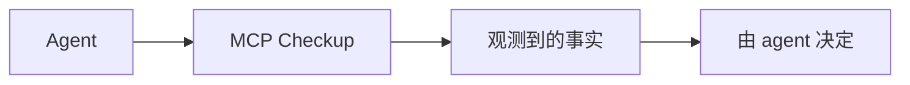

<h1 align="center">MCP Checkup</h1>

<p align="center"><strong>在 agent 连接之前，先看一眼。</strong></p>

<p align="center">
  <a href="https://github.com/mcpcheckup/.github/blob/main/profile/README.md">English</a>
  · <strong>简体中文</strong>
  · <a href="https://github.com/mcpcheckup/.github/blob/main/profile/README.zh-TW.md">繁體中文</a>
  · <a href="https://github.com/mcpcheckup/.github/blob/main/profile/README.de.md">Deutsch</a>
  · <a href="https://github.com/mcpcheckup/.github/blob/main/profile/README.ja.md">日本語</a>
  · <a href="https://github.com/mcpcheckup/.github/blob/main/profile/README.es.md">Español</a>
  · <a href="https://github.com/mcpcheckup/.github/blob/main/profile/README.fr.md">Français</a>
</p>

<p align="center">
  <a href="https://mcpcheckup.com/mcp"></a>
  <a href="https://github.com/mcpcheckup/checks#use-mcp-checkup-from-your-agent"></a>
  <a href="https://github.com/mcpcheckup/checks/blob/main/LICENSE"></a>
  <a href="https://github.com/mcpcheckup/preflight/blob/main/LICENSE"></a>
</p>

MCP Checkup 观察公开的 MCP 服务器，并公布某一次运行实际看到的东西：端点有没有应答、它说的是哪一版协议、工具名和每个工具 `inputSchema` 的指纹、不带凭据就能看到的认证元数据，以及工具名和描述里的卫生信号。签过名的运行是一份你可以自己核验的证明。没有签名的运行，就如实标成未签名的观测。

记录事实，不下结论。每一项检查只落在 `VERIFIED`、`FAILED`、`OBSERVED_RISK`、`UNVERIFIED` 四者之一。检查结果不会被合成一个分数或一份裁决；没跑的检查永远不会被写成通过；结果也不是连接与否的闸门。决定权在 agent。

- 目录：[mcpcheckup.com/servers](https://mcpcheckup.com/servers)
- MCP 端点，Streamable HTTP，不用账号，也不用 API key：`https://mcpcheckup.com/mcp`
- 官方 MCP Registry：`com.mcpcheckup/mcp`
- 同时收录于 [Claude Connectors Directory](https://claude.ai/directory/connectors/mcp-checkup)（社区连接器）、[MCP Collection](https://mcpcollection.com/server/mcp-checkup) 和 [ToolSDK MCP Registry](https://toolsdk-ai.github.io/toolsdk-mcp-registry/#%40toolsdk-remote%2Fmcpcheckup)

## 记录什么

检查套件对协议本身做 15 项检查。下表是简表。定义、失败语义和探测预算在 [`checks.json`](https://github.com/mcpcheckup/checks/blob/main/packages/checks/checks.json) 和[方法学](https://mcpcheckup.com/methodology)页面。

| 检查 | 一次运行记录什么 |
| --- | --- |
| `reachability` | 端点是否在探测预算内返回了响应。超出预算记 `UNVERIFIED`，不是 `FAILED`。 |
| `latency_profile` | 探测计时请求的 p50 和 p95。`VERIFIED` 只表示测到了时间，没有快慢阈值，也不排名。 |
| `transport_type` | 握手是否在探测所用的传输上得到了应答。 |
| `protocol_revision` | 是否识别出已知的协议修订。这不是在说该修订已被完整实现。 |
| `discovery_handshake` | `server/discover` 或旧式 `initialize` 握手是否符合已识别的修订。 |
| `tools_list` | `tools/list` 是否返回结构合法的工具列表。业务工具从不被调用。 |
| `error_taxonomy` | 发出预留调用时，错误形状是否符合协议。偏差记 `OBSERVED_RISK`。 |
| `tls_certificate` | 证书是否有效、未过期、名称匹配、链完整。这不是在说服务器是安全的。 |
| `redirect_policy` | 重定向是否跨到了另一台主机。跨主机重定向记 `OBSERVED_RISK`。 |
| `auth_metadata` | 公开可观察的认证元数据，或在没有凭据时看到的质询，结构是否合法。结构不合法记 `OBSERVED_RISK`。完全观察不到则记 `UNVERIFIED`。这不检验认证是否真的被执行。探测从不发送凭据。 |
| `tool_description_hygiene` | 工具名和描述中的信号，包括隐藏字符和写给 agent 看的文字。命中记 `OBSERVED_RISK`，不是对意图的判断。 |
| `toolset_fingerprint` | 工具名的 SHA-256。`VERIFIED` 表示指纹算得出来，不表示列表没变。 |
| `schema_fingerprint` | 每个工具 `inputSchema` 的 SHA-256。只判断算不算得出来。描述变了，两个指纹都不动。 |
| `toolset_unchanged_vs_approved` | 工具名是否与已批准的基线一致。没有基线时保持 `UNVERIFIED`。 |
| `schema_unchanged_vs_approved` | 每个 `inputSchema` 是否与已批准的基线一致。没有基线时保持 `UNVERIFIED`。 |

工具名、参数和描述的变化，由 [`packages/toolset-diff`](https://github.com/mcpcheckup/checks/tree/main/packages/toolset-diff) 按工具对比，并出现在 `get_mcp_history` 里。

## 如何运作

MCP 注册表里列出的公开端点，再加上一小批手工挑出的服务器，不需要运营者注册就会被检查。还没有人认领的服务器，每 12 小时重查一次。已认领服务器的报告页会标出它当前的检查周期。

一次运行只读服务器外面看得到的东西。不审计源代码，不调用业务工具，不发送凭据。为了走一条错误路径，它会调用一个预留的工具名，这个名字按设计不应当存在。如果列表里已经有这个名字、列表没法读完，或者服务器要求凭据，这次调用就会跳过。

工具名和 `inputSchema` 的指纹，是 `nfc-jcs/v1` 投影的 SHA-256：先做 Unicode NFC，再做 RFC 8785 的 JSON 规范化。方法学说明，这一组合形式本身不叫 RFC 8785，因为该规范禁止额外的规范化步骤。指纹只覆盖投影里的字段，旁边多出来的字段不会改变指纹，描述变了也不会。

签过名的运行会写明检查套件的提交，以及针对 `packages/checks` 的 `suite_digest`，放在用 Ed25519 签名的 DSSE 信封里。公钥发布在 [`mcpcheckup.com/.well-known/mcpcheckup-keys.json`](https://mcpcheckup.com/.well-known/mcpcheckup-keys.json)，[`checks`](https://github.com/mcpcheckup/checks/blob/main/keys/mcpcheckup-keys.json) 仓库里有一份副本。没有签名的运行就是未签名观测：看到了什么就写什么，不附通过或未通过的结论。有没有人认领，签名方式都一样。

探测请求的 User-Agent 是 `MCPCheckup-Probe/1.0 (+https://mcpcheckup.com/probe)`。该页写明了请求预算，以及如何退出检查。



MCP Checkup 交回事实。它不给服务器打分，也不决定 agent 连不连。

## 四种状态，从没有分数

| 状态 | 含义 |
| --- | --- |
| `VERIFIED` | 这一轮、对这个端点，检查跑过了，断言成立。 |
| `FAILED` | 检查跑过了，断言不成立。 |
| `OBSERVED_RISK` | 观察到一个信号。这不是通过或未通过的裁决。 |
| `UNVERIFIED` | 这一轮这项检查没有得出结果，并且写明了原因。`UNVERIFIED` 永远不当成通过。 |

执行状态（`completed`、`errored`、`skipped`、`blocked`）另行记录，不会被折进通过次数。

## 为什么上个月的工具列表不够

你批准一台服务器，批准的是它当天提供的那些工具。之后它可能新增、删除或重命名工具，改掉 `inputSchema`，或重写描述。这种悄悄换掉的做法，就是人们说的 rug pull。

MCP Checkup 不会把一台服务器标成 rug pull。它记下差别。

- `toolset_fingerprint` 是工具名，`schema_fingerprint` 是每个 `inputSchema`。指纹本身不说明好坏，它是任何人都能复算的值。
- `get_mcp_history` 列出名称、参数和描述的近期变化。
- 只有跟某个人批准过的基线不一致时，差别才会记成 `FAILED`：`toolset_unchanged_vs_approved` 和 `schema_unchanged_vs_approved`。方法学把 `schema_unchanged_vs_approved` 称为针对 rug pull 最直接的一项检查。没有基线时，两项都保持 `UNVERIFIED`，变化只是一条已记录的事实。在未认领的服务器上，`schema_unchanged_vs_approved` 只能是 `UNVERIFIED`。

一份干净的报告，记录的是当时检查了什么、看到了什么。它不保证两次运行之间端点会怎样。

## 快速开始

不需要 MCP Checkup 账号，也不需要 API key。六个工具的说明在 [mcpcheckup.com/agents](https://mcpcheckup.com/agents)。

### Claude Code

preflight 插件带着同一条指令：连接之前先查这台服务器。

```text
/plugin marketplace add mcpcheckup/preflight
/plugin install mcp-preflight@mcpcheckup
```

把 MCP Checkup 自己接上：

```sh
claude mcp add --transport http mcpcheckup https://mcpcheckup.com/mcp
```

加上 `--scope user`，每个项目都能用。

在 Claude 里打开 Customize → Connectors → Browse，搜索 MCP Checkup。也可以添加自定义连接器，名称填 MCP Checkup，地址粘贴 `https://mcpcheckup.com/mcp`，认证选不登录。

### Cursor

把 [`.cursor/rules/mcp-preflight.mdc`](https://github.com/mcpcheckup/preflight/blob/main/.cursor/rules/mcp-preflight.mdc) 复制到你仓库的 `.cursor/rules/`。

单个项目用 `.cursor/mcp.json`，所有项目用 `~/.cursor/mcp.json`：

```json
{"mcpServers":{"mcpcheckup":{"url":"https://mcpcheckup.com/mcp"}}}
```

### 任意 MCP 客户端

```json
{ "mcpServers": { "mcpcheckup": { "type": "http", "url": "https://mcpcheckup.com/mcp" } } }
```

Streamable HTTP，不需要认证。很多 agent 可以自己完成：让它读 `https://mcpcheckup.com/agents`，再把 MCP Checkup 这台服务器加上。该页还有对照其他客户端文档核对过的接入步骤。

### AGENTS.md

把 [`AGENTS.md`](https://github.com/mcpcheckup/preflight/blob/main/AGENTS.md) 的正文复制到你仓库根目录的 `AGENTS.md`。它和 Cursor 规则、Claude Code 插件是同一条指令。在添加、推荐或调试一台 MCP 服务器之前先查它。把观测到的内容告诉使用者，包括标成 `UNVERIFIED` 的项和原因。不要把结果变成对这台服务器的评判。

## 工具

六个工具里有五个只根据已经记录的内容作答，不会去联系你问到的那台服务器。会去联系的是 `request_check`。

| 工具 | 做什么 |
| --- | --- |
| `check_mcps` | 按 `provider/name`、端点 URL 或域名返回已观测的事实。还没追踪的目标返回 `unknown`，不是错误。它从不会当场探测。 |
| `get_mcp_report` | 一台已追踪服务器的每一项检查及其状态，加上观测到的工具列表。 |
| `get_mcp_history` | 一台已追踪服务器的近期变化：工具名、参数、描述，以及协议修订。 |
| `get_attestation` | 最近一次探测运行的签名证明信封（DSSE、Ed25519），有的话就返回。没有可返回的内容时，原因写明，不算工具错误。 |
| `search_mcps` | 按工具名和描述查找已追踪的服务器。每条摘要由观测到的工具名生成，是不可信的第三方文本。 |
| `request_check` | 对一个完整的 `http://` 或 `https://` 端点做一次未签名观测。它只联系你点名的那台主机，所以先问过使用者。结果不签名、不存成一次运行、也不生成报告页。不保证被收进目录。 |

每个 IP 每分钟大约 20 次请求，按 Cloudflare 节点分别计数。`429` 响应带 `Retry-After`（60 秒）。

## 仓库

[`checks`](https://github.com/mcpcheckup/checks) 的 README 写明采用 Apache License 2.0。两个公开仓库都带有 Apache License 2.0 的 `LICENSE` 文件。

| 仓库 | 用来做什么 |
| --- | --- |
| [`preflight`](https://github.com/mcpcheckup/preflight) | 同一条指令的三个落点：Claude Code 插件、Cursor 规则，以及一段 `AGENTS.md`，都是让 agent 在连接前先到 MCP Checkup 上查这台服务器。 |
| [`checks`](https://github.com/mcpcheckup/checks) | 检查套件、签名证明所用的规范器和模式、工具集差异对比，以及离线验证器。以私有 monorepo 的快照发布。这里不合并 pull request。 |

## 离线核对我们的工作

签名载荷用 `suite_commit` 和 `suite_digest` 标明产出它的代码。克隆 [`checks`](https://github.com/mcpcheckup/checks) 后，把 `<commit>` 换成那个 `suite_commit`：

```sh
git ls-tree -r -z --full-tree <commit> -- packages/checks | openssl dgst -sha512 -binary | openssl base64 -A
```

在输出前加上 `sha512-`，再和 `suite_digest` 比较。这条命令只读已提交的 git 对象，换行符和平台都不影响结果。只有当 `suite_commit` 是这个公开仓库里的提交时才算得出来。如果载荷里的 `suite_commit` 早于这些提交被公开，它指向的是私有 monorepo，摘要无法在这里复算。

验证信封需要 22 线的 Node.js 22.18 或更高版本，或者 Node.js 24 或更高版本。不用安装依赖。验证器自己不发起网络请求。

用线上的密钥文档：

```sh
curl -fsS https://mcpcheckup.com/.well-known/mcpcheckup-keys.json -o keys.json
node packages/verifier/verify-attestation.mjs --envelope <file> --keys keys.json
```

离线时用克隆里的副本：

```sh
node packages/verifier/verify-attestation.mjs --envelope <file> --keys keys/mcpcheckup-keys.json
```

对每个签名，它检查 `keyid` 在文档中、密钥未被吊销，以及 `observed_at` 落在 `valid_from` 和 `valid_until` 之内（两端都包含）。它不认识的 `payloadType` 会被拒绝。仓库里的副本要到下一次快照才更新，在那之前线上文档可能更新。其他差异报到 [`SECURITY.md`](https://github.com/mcpcheckup/checks/blob/main/SECURITY.md)。

## 维护者

你的服务器也许已经有报告页。[mcpcheckup.com/maintainers](https://mcpcheckup.com/maintainers) 说明认领会改变什么。证明你控制这个地址，靠一条 DNS TXT 记录或一个 `.well-known` 文件。从不索要凭据。

目录在 [mcpcheckup.com/servers](https://mcpcheckup.com/servers)：每台服务器现在暴露什么，是我们观测到的，不是对方自称的。可以按名称、地址、工具名或描述搜索。

如果请求带着探测的 User-Agent，[mcpcheckup.com/probe](https://mcpcheckup.com/probe) 说明了请求预算，以及如何退出检查。
