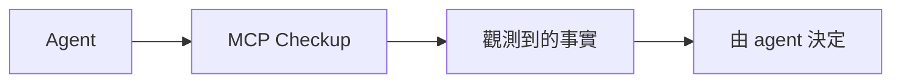

<h1 align="center">MCP Checkup</h1>

<p align="center"><strong>agent 連線之前，先看清楚。</strong></p>

<p align="center">
  <a href="https://github.com/mcpcheckup/.github/blob/main/profile/README.md">English</a>
  · <a href="https://github.com/mcpcheckup/.github/blob/main/profile/README.zh-CN.md">简体中文</a>
  · <strong>繁體中文</strong>
  · <a href="https://github.com/mcpcheckup/.github/blob/main/profile/README.de.md">Deutsch</a>
  · <a href="https://github.com/mcpcheckup/.github/blob/main/profile/README.ja.md">日本語</a>
  · <a href="https://github.com/mcpcheckup/.github/blob/main/profile/README.es.md">Español</a>
  · <a href="https://github.com/mcpcheckup/.github/blob/main/profile/README.fr.md">Français</a>
</p>

<p align="center">
  <a href="https://mcpcheckup.com/mcp"></a>
  <a href="https://github.com/mcpcheckup/checks#use-mcp-checkup-from-your-agent"></a>
  <a href="https://github.com/mcpcheckup/checks/blob/main/LICENSE"></a>
  <a href="https://github.com/mcpcheckup/preflight/blob/main/LICENSE"></a>
</p>

MCP Checkup 觀察公開的 MCP 伺服器，並公開某一次執行實際看到的內容：端點有沒有回應、它講的是哪一版協定、工具名稱與每個工具 `inputSchema` 的指紋、不帶憑據就看得到的驗證中繼資料，以及工具名稱和說明裡的衛生訊號。有簽章的執行是一份你可以自己核對的證明。沒有簽章的執行，就如實標成未簽章的觀測。

它記下事實，不下判斷。每一項檢查只會落在 `VERIFIED`、`FAILED`、`OBSERVED_RISK`、`UNVERIFIED` 其中一個。檢查不會被加成一個分數或一份裁決；沒跑的檢查絕不會被寫成通過；結果也不是連不連得上的閘門。要不要連，由 agent 決定。

- 目錄：[mcpcheckup.com/servers](https://mcpcheckup.com/servers)
- MCP 端點，Streamable HTTP，不用帳號，也不用 API key：`https://mcpcheckup.com/mcp`
- 官方 MCP Registry：`com.mcpcheckup/mcp`
- 同時列在 [Claude Connectors Directory](https://claude.ai/directory/connectors/mcp-checkup)（社群連接器）、[MCP Collection](https://mcpcollection.com/server/mcp-checkup)，以及 [ToolSDK MCP Registry](https://toolsdk-ai.github.io/toolsdk-mcp-registry/#%40toolsdk-remote%2Fmcpcheckup)

## 記錄了什麼

這套檢查針對協定本身，一共 15 項。下表是簡表。定義、失敗時的語意，以及探測預算，寫在 [`checks.json`](https://github.com/mcpcheckup/checks/blob/main/packages/checks/checks.json) 和[方法說明](https://mcpcheckup.com/methodology)。

| 檢查 | 一次執行記錄什麼 |
| --- | --- |
| `reachability` | 端點是否在探測預算內回了回應。超出預算記 `UNVERIFIED`，不是 `FAILED`。 |
| `latency_profile` | 探測有計時的請求的 p50 與 p95。`VERIFIED` 只表示量到了時間，沒有快慢門檻，也不排名。 |
| `transport_type` | 交握是否在探測所用的傳輸上得到回應。 |
| `protocol_revision` | 是否辨識出已知的協定修訂。這不是在說該修訂已經完整實作。 |
| `discovery_handshake` | `server/discover` 或舊式 `initialize` 交握是否符合已辨識的修訂。 |
| `tools_list` | `tools/list` 是否回傳結構合法的工具清單。業務工具絕不會被呼叫。 |
| `error_taxonomy` | 有送出預留呼叫時，錯誤的形狀是否符合協定。偏差記 `OBSERVED_RISK`。 |
| `tls_certificate` | 憑證是否有效、未過期、名稱相符、憑證鏈完整。這不是在說伺服器很安全。 |
| `redirect_policy` | 重新導向是否跨到另一台主機。跨主機重新導向記 `OBSERVED_RISK`。 |
| `auth_metadata` | 公開可觀察的驗證中繼資料，或在沒有憑據時看到的質詢，結構是否合法。結構不合法記 `OBSERVED_RISK`。完全觀察不到則記 `UNVERIFIED`。這不測試驗證是否真的有被執行。探測絕不送出憑據。 |
| `tool_description_hygiene` | 工具名稱和說明裡的訊號，包括隱藏字元，以及寫給 agent 看的文字。命中記 `OBSERVED_RISK`，不是對意圖的判斷。 |
| `toolset_fingerprint` | 工具名稱的 SHA-256。`VERIFIED` 表示指紋算得出來，不表示清單沒變。 |
| `schema_fingerprint` | 每個工具 `inputSchema` 的 SHA-256。只判斷算不算得出來。說明改了，兩個指紋都不會動。 |
| `toolset_unchanged_vs_approved` | 工具名稱是否與已核准的基線一致。沒有基線時維持 `UNVERIFIED`。 |
| `schema_unchanged_vs_approved` | 每個 `inputSchema` 是否與已核准的基線一致。沒有基線時維持 `UNVERIFIED`。 |

工具名稱、參數和說明的變化，由 [`packages/toolset-diff`](https://github.com/mcpcheckup/checks/tree/main/packages/toolset-diff) 逐項比對，也會出現在 `get_mcp_history`。

## 怎麼運作

列在 MCP registry 裡的公開端點，再加上一小批人工挑選的伺服器，營運者不註冊也會被檢查。還沒有人認領的伺服器，每 12 小時重查一次。已認領的伺服器，報告頁會標出它目前的檢查週期。

一次執行只讀伺服器外面看得到的東西。不審查原始碼，不呼叫業務工具，不送出憑據。為了走一條錯誤路徑，它會呼叫一個預留的工具名稱，這個名稱按設計不應該存在。如果清單裡已經有這個名稱、清單讀不完，或伺服器要求憑據，這次呼叫就會略過。

工具名稱和 `inputSchema` 的指紋，是 `nfc-jcs/v1` 投影的 SHA-256：先做 Unicode NFC，再做 RFC 8785 的 JSON 正規化。方法說明寫得很清楚，這個組合本身不叫 RFC 8785，因為該規範禁止多加正規化。指紋只覆蓋投影裡的欄位，旁邊多出來的欄位不會改變指紋，說明改了也不會。

有簽章的執行會寫明檢查套件的 commit，以及針對 `packages/checks` 的 `suite_digest`，放在以 Ed25519 簽章的 DSSE 信封裡。公鑰公布在 [`mcpcheckup.com/.well-known/mcpcheckup-keys.json`](https://mcpcheckup.com/.well-known/mcpcheckup-keys.json)，[`checks`](https://github.com/mcpcheckup/checks/blob/main/keys/mcpcheckup-keys.json) 裡留有一份複本。沒有簽章的執行就是未簽章觀測：看到什麼寫什麼，不附通過或未通過的結論。有沒有人認領，簽章方式都一樣。

探測送出的 User-Agent 是 `MCPCheckup-Probe/1.0 (+https://mcpcheckup.com/probe)`。那一頁寫了請求預算，以及如何退出檢查。



MCP Checkup 交回事實。它不替伺服器打分數，也不決定 agent 要不要連。

## 四種狀態，不打分數

| 狀態 | 意思 |
| --- | --- |
| `VERIFIED` | 這一輪、對這個端點，檢查有跑，斷言成立。 |
| `FAILED` | 檢查有跑，斷言不成立。 |
| `OBSERVED_RISK` | 觀察到一個訊號。這不是通過或未通過的裁決。 |
| `UNVERIFIED` | 這一輪這項檢查沒有得出結果，而且寫明原因。`UNVERIFIED` 絕不當成通過。 |

執行狀態（`completed`、`errored`、`skipped`、`blocked`）另外記錄，不會被折進通過次數。

## 為什麼上個月的工具清單不夠

你核准一台伺服器，核准的是它當天提供的那些工具。之後它可能新增、移除或重新命名工具，改掉 `inputSchema`，或重寫說明。這種不聲張就換掉的做法，就是大家說的 rug pull。

MCP Checkup 不會把一台伺服器標成 rug pull。它記下差異。

- `toolset_fingerprint` 是工具名稱，`schema_fingerprint` 是每個 `inputSchema`。指紋本身不說明好壞，它是任何人都能重算的值。
- `get_mcp_history` 列出名稱、參數和說明的近期變化。
- 只有跟某個人核准過的基線不一致時，差異才會記成 `FAILED`：`toolset_unchanged_vs_approved` 和 `schema_unchanged_vs_approved`。方法說明把 `schema_unchanged_vs_approved` 稱為針對 rug pull 最直接的一項檢查。沒有基線時，兩項都維持 `UNVERIFIED`，變化只是一筆已記錄的事實。在未認領的伺服器上，`schema_unchanged_vs_approved` 只能是 `UNVERIFIED`。

一份乾淨的報告，記錄的是當時檢查了什麼、看到了什麼。它不保證兩次執行之間端點會怎樣。

## 快速開始

不需要 MCP Checkup 帳號，也不需要 API key。六個工具的說明在 [mcpcheckup.com/agents](https://mcpcheckup.com/agents)。

### Claude Code

preflight 外掛帶著同一條指令：連線之前先查這台伺服器。

```text
/plugin marketplace add mcpcheckup/preflight
/plugin install mcp-preflight@mcpcheckup
```

把 MCP Checkup 自己接上：

```sh
claude mcp add --transport http mcpcheckup https://mcpcheckup.com/mcp
```

加上 `--scope user`，每個專案都能用。

在 Claude 裡打開 Customize → Connectors → Browse，搜尋 MCP Checkup。也可以新增自訂連接器，名稱填 MCP Checkup，位址貼上 `https://mcpcheckup.com/mcp`，驗證方式選不登入。

### Cursor

把 [`.cursor/rules/mcp-preflight.mdc`](https://github.com/mcpcheckup/preflight/blob/main/.cursor/rules/mcp-preflight.mdc) 複製到你儲存庫的 `.cursor/rules/`。

單一專案用 `.cursor/mcp.json`，所有專案用 `~/.cursor/mcp.json`：

```json
{"mcpServers":{"mcpcheckup":{"url":"https://mcpcheckup.com/mcp"}}}
```

### 任何 MCP 用戶端

```json
{ "mcpServers": { "mcpcheckup": { "type": "http", "url": "https://mcpcheckup.com/mcp" } } }
```

Streamable HTTP，不需要驗證。很多 agent 可以自己完成：讓它讀 `https://mcpcheckup.com/agents`，再把 MCP Checkup 這台伺服器加上。那一頁還有對照其他用戶端文件核對過的設定步驟。

### AGENTS.md

把 [`AGENTS.md`](https://github.com/mcpcheckup/preflight/blob/main/AGENTS.md) 的正文複製到你儲存庫根目錄的 `AGENTS.md`。它和 Cursor 規則、Claude Code 外掛是同一條指令。在新增、推薦或除錯一台 MCP 伺服器之前先查它。把觀測到的內容告訴使用者，包括標成 `UNVERIFIED` 的項目和原因。不要把結果變成對這台伺服器的評判。

## 工具

六個工具裡有五個只根據已經記錄的內容回答，不會去連你問到的那台伺服器。會去連的是 `request_check`。

| 工具 | 做什麼 |
| --- | --- |
| `check_mcps` | 依 `provider/name`、端點 URL 或網域回傳已觀測的事實。還沒追蹤的目標回 `unknown`，不是錯誤。它絕不會當場探測。 |
| `get_mcp_report` | 一台已追蹤伺服器的每一項檢查及其狀態，加上觀測到的工具清單。 |
| `get_mcp_history` | 一台已追蹤伺服器的近期變化：工具名稱、參數、說明，以及協定修訂。 |
| `get_attestation` | 最近一次探測執行的簽章證明信封（DSSE、Ed25519），有的話就回傳。沒有可回傳的內容時，原因會寫明，不算工具錯誤。 |
| `search_mcps` | 依工具名稱和說明尋找已追蹤的伺服器。每則摘要由觀測到的工具名稱產生，是不可信的第三方文字。 |
| `request_check` | 對一個完整的 `http://` 或 `https://` 端點做一次未簽章觀測。它只連你點名的那台主機，所以先問過使用者。結果不簽章、不存成一次執行，也不會產生報告頁。不保證被收進目錄。 |

每個 IP 每分鐘大約 20 次請求，依 Cloudflare 節點分別計數。`429` 回應帶 `Retry-After`（60 秒）。

## 儲存庫

[`checks`](https://github.com/mcpcheckup/checks) 的 README 寫明採用 Apache License 2.0。兩個公開儲存庫都附有 Apache License 2.0 的 `LICENSE` 檔。

| 儲存庫 | 用來做什麼 |
| --- | --- |
| [`preflight`](https://github.com/mcpcheckup/preflight) | 同一條指令的三個落點：Claude Code 外掛、Cursor 規則，以及一段 `AGENTS.md`，都是讓 agent 在連線前先到 MCP Checkup 查這台伺服器。 |
| [`checks`](https://github.com/mcpcheckup/checks) | 檢查套件、簽章證明所用的正規化器與綱要、工具集差異比對，以及離線驗證器。以私有 monorepo 的快照發布。這裡不合併 pull request。 |

## 離線核對我們的結果

簽章載荷用 `suite_commit` 和 `suite_digest` 標明產生它的程式碼。在 [`checks`](https://github.com/mcpcheckup/checks) 的複本裡，把 `<commit>` 換成那個 `suite_commit`：

```sh
git ls-tree -r -z --full-tree <commit> -- packages/checks | openssl dgst -sha512 -binary | openssl base64 -A
```

在輸出前面加上 `sha512-`，再和 `suite_digest` 比較。這條指令只讀已提交的 git 物件，換行符號和平台都不影響結果。只有當 `suite_commit` 是這個公開儲存庫裡的 commit 時才算得出來。如果載荷裡的 `suite_commit` 早於這些 commit 被公開，它指向的是私有 monorepo，摘要無法在這裡重算。

驗證信封需要 22 線的 Node.js 22.18 或更新版本，或 Node.js 24 或更新版本。不用安裝套件。驗證器本身不發出網路請求。

用線上的金鑰文件：

```sh
curl -fsS https://mcpcheckup.com/.well-known/mcpcheckup-keys.json -o keys.json
node packages/verifier/verify-attestation.mjs --envelope <file> --keys keys.json
```

離線時用複本裡的那份：

```sh
node packages/verifier/verify-attestation.mjs --envelope <file> --keys keys/mcpcheckup-keys.json
```

對每個簽章，它檢查 `keyid` 在文件中、金鑰未被撤銷，以及 `observed_at` 落在 `valid_from` 和 `valid_until` 之內（兩端都算）。它不認識的 `payloadType` 會被拒絕。儲存庫裡的複本要到下一次快照才更新，在那之前線上文件可能比較新。其他差異見 [`SECURITY.md`](https://github.com/mcpcheckup/checks/blob/main/SECURITY.md)。

## 維護者

你的伺服器也許已經有報告頁。[mcpcheckup.com/maintainers](https://mcpcheckup.com/maintainers) 說明認領會改變什麼。證明你控制這個位址，靠一筆 DNS TXT 紀錄或一個 `.well-known` 檔案。絕不索取憑據。

目錄在 [mcpcheckup.com/servers](https://mcpcheckup.com/servers)：每台伺服器現在暴露什麼，是我們觀測到的，不是對方自己宣稱的。可以依名稱、位址、工具名稱或說明搜尋。

如果請求帶著探測的 User-Agent，[mcpcheckup.com/probe](https://mcpcheckup.com/probe) 說明了請求預算，以及如何退出檢查。
